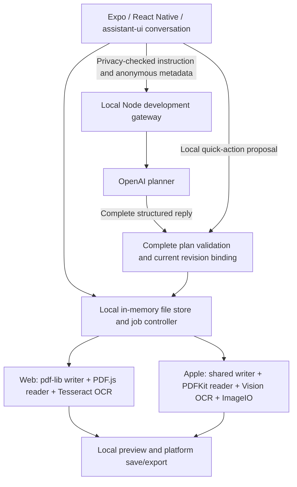

# Architecture

Current implementation: `prototype-v0` plus the preserved uncommitted quick-action change of 29 September 2026. The diagram and source descriptions below describe what exists, not the approved v1 target. [PRODUCT_V1.md](PRODUCT_V1.md), especially Sections 6–11 and 14, governs future architecture requirements; adoption authorizes no implementation or replacement.

`apps/universal/App.tsx` owns presentation orchestration. The assistant-ui external-store adapter receives chat presentation entries, not automatically uploaded PDF attachments. Platform files under `src/platform` handle selection/drop, preview, planner connection and save. Native custom modules bridge PDF and planner transport. Mac uses Catalyst.

**Current-source/target mismatch:** explicit quick-action buttons call `controller.quick()` directly, independent of planner transport, status, key and allowance. `quickPlan()` validates the local proposal and `JobController.execute()` revalidates it against the current revision, capabilities and local file facts before running engines. Image-quality-changing compression retains its revision-bound confirmation. Typed requests retain the existing `preparePlanning()` path and bounded local fallback; ambiguous text is not promoted to a quick action. This bypass is not the v1 routing decision: D-04/CONV-01 intentionally retain AI orchestration. The prior change is preserved, and restoring routing or choosing provider-recovery behavior requires a separate task.

`packages/core` owns immutable originals, artifact lineage, revision, undo history and serialized jobs. Import is atomic across the selected batch; execution stages a complete validated plan and commits a final output after independent reading. Cancellation and stale-plan checks protect committed state. Store and history are memory-only. Undo changes focus/history but does not evict stored byte buffers.

`packages/contracts` contains the shared JSON schemas, generated validators, operation registry and synthetic corpus. `packages/web-pdf` contains the shared pdf-lib writer, conservative feature/content admission, browser worker and separate PDF.js inspection. Apple uses PDFKit/Vision/ImageIO through the local module. Independence means different writer and reader engines; it is not proof of identical pixels or preservation of every PDF semantic structure.

`packages/planner` handles request projection, privacy guards, model tool schema, response validation, local credentials/allowance, browser authentication, native pairing and the optional private TLS companion. Only complete validated tool proposals reach the local controller. No backend PDF engine or cloud fallback is present.

The exported web interface can be served by the owned beta host, older standalone preview host or optional Next host. Next's root route returns raw Expo HTML. Its legacy DOM workspace is unreachable from the active route. Hosts currently differ in protections and asset handling. See [repository audit](audit/REPOSITORY_AND_BUILD_AUDIT.md).

`packages/commerce` is a disconnected synthetic domain experiment. It is not part of active purchase or entitlement enforcement. Android source is preserved but integration is unfinished and deferred.

## Boundaries needing decisions or verification

- Session retention and repeated full-buffer copies limit practical capacity; long histories also conflict with planner/protocol file-count bounds.
- Follow-up questions have no maintained conversation binding in planner requests.
- Root directories are source modules under one dependency importer, not independently packaged workspaces.
- Generated contracts/assets/product facts and multiple hosts need a reproducible release gate.
- V1 selects company-supplied hosted AI, both Mac distribution channels and local workspace restoration. Authentication, production provider/hosting, channel entitlement/update mechanisms and protected recovery storage remain open implementation decisions (OPEN-01–10).

## Approved target references, not implemented systems

Mac is the acceptance platform (D-01/D-02, MAC-01–04). Preserve the working Expo/React Native/Mac Catalyst foundation unless a bounded investigation justifies an approved change (ARCH-01). Conversation and local understanding require bounded authoritative context and locally resolved selectors (CONV-03–05, UNDERSTAND-01–06). Persistence and retention require protected, crash-consistent local state without implied sync (STATE-01–07).

Future structured AI proposals still pass schema, semantic, capability, file/revision, resource, consent and commercial authorization boundaries before deterministic local execution and independent inspection. Approval of a target is not an implementation of these additional controls. Content-transfer consent and secret isolation follow PRIV-01–11/PDF-06–08; guest/Pro and safety limits are distinct under BILL-01–10. See the specification for requirements, not a second architecture roadmap here.
