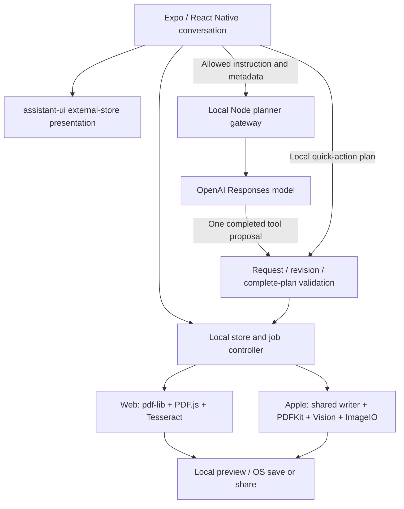

# atepdf — prototype-v0 repository audit

**Date:** 29 September 2026. **Mode:** preservation and read-only product/source audit. **Repository:** `/Users/shrey/Documents/ChatGPT/atepdf`. **Audited HEAD:** `06539eb28460cd3055e846b7caf509e1b0794a8a`. **Application snapshot:** annotated `prototype-v0` → `5a6c0c542603cdb2a72bcdb2a91958ef3b6f12ab`. Branch: `codex/atepdf-chat-workflows`.

This is the requested consolidated audit. Repository source, manifests, caller/route relationships, test definitions and checked-in result artifacts are primary evidence. Earlier conversation is not used as proof of implementation or working behavior. The earlier reports under `docs/audit/` are supporting review records, not substitutes for source. No application source differs between the tag and audited HEAD; the latter adds documentation only.

**Preservation:** Git status was clean at intake: no modified, staged or non-ignored untracked work. History was inspected; the existing tag already preserves the prototype and was neither recreated nor moved. No reset, cleanup, deletion or history rewrite occurred. The tag excludes ignored credentials, installed dependencies, generated builds, caches and live session memory. It is a recoverable source snapshot, not a backup of those external/runtime states. The pre-existing [freeze record](audit/PROTOTYPE_V0_FREEZE.md) lists the files preserved when that tag was created. This request adds only this audit file, committed separately.

**Method and limits:** the full tracked tree and Markdown inventory were enumerated; all first-party application/package/host/native/test/configuration areas are covered by source review and the unchanged-source specialist records. Active PDF/AI/state/host paths and key evidence were rechecked. Generated validators were followed to their schemas; vendor internals and historical binary artifacts were sampled where relevant, not exhaustively certified. No build, test, application, server, simulator, installer, paid call, remote scan or old Attenlo command was run. No secret/private configuration contents were read. All runtime claims below are explicitly historical and scoped; current running products were not probed. No recommendation was implemented and existing documents were not rewritten.

## 1. Executive summary

atepdf has a real, narrow local PDF application, not just mock screens. Its shared Expo/React Native conversation can run supported PDF import → merge → independent reader check → inline preview/save → page removal → Undo. Web and selected Apple simulator/helper workflows have checked-in execution evidence. English OCR and JPEG compression also have real-engine evidence within restrictive boundaries.

The architecture separates local file truth, job control, plan contracts, model transport and presentation. This is worth keeping. **The evidence does not justify a rebuild or framework replacement.** It also does not establish a production-ready general PDF utility.

The most consequential findings are:

- **Supported PDFs are limited.** Encrypted documents and many forms, annotations/links, outlines/bookmarks, tagged structures and active-content features are refused. Upstream library support and registry entries do not make them product features.
- **Validation is incomplete as a fidelity guarantee.** The separate reader verifies count, dimensions, rotation and normalized text. It cannot reliably detect missing images, equal-size scanned-page swaps, changed crop origins or shifted hidden OCR.
- **Several conversational paths are incomplete or broken.** Clarification context/choices are not retained; Cancel during sample fetching does not own that work; enabled-provider failure lacks direct local shortcut recovery; retained history eventually breaches request limits.
- **Large-file safety is not proven.** There is no 20 MB byte limit, but whole-file copies, memory-only retained artifacts and browser JPEG decoding before encoded-dimension checks remain risks. Page/file/pixel/time bounds still exist.
- **Privacy controls are useful but narrower than some wording.** Artifact serialization excludes PDF content and identifying local fields. Free-form instructions may still contain undetected sensitive text; recognized rejected secrets remain visible in local chat.
- **Infrastructure is private-development infrastructure.** Local tokens/pairing are not production account authentication. An inherited provider endpoint and the older preview host create conditional risks. Billing consists of disabled pure contracts. CI/public distribution and broad platform acceptance are absent or unknown.

The correct next decision is a bounded production scope and verification standard, followed by explicitly authorized work. No launch date or completion percentage can be substantiated from this repository alone.

### Capability classifications used here

| Required classification | Evidence rule |
|---|---|
| IMPLEMENTED AND WORKING | Active source plus relevant recorded successful execution; always restricted to the cited fixture/platform/source. Does **not** mean freshly rerun, broadly compatible or production-ready |
| IMPLEMENTED BUT NEEDS VERIFICATION | Reachable implementation exists, but matching functional/platform evidence is absent or insufficient |
| PARTIALLY IMPLEMENTED | Some journey/contract works; material behavior, integration or scope is missing |
| BROKEN | A deterministic source-path contradiction is established, or recorded failure remains unresolved. Static proof is labelled; it is not presented as a new runtime reproduction |
| PLANNED / SCAFFOLDED ONLY | Recorded intent or schema/domain scaffolding, without an active user execution path |
| DEAD / ABANDONED | No current caller/entry found or explicitly superseded implementation; this is not permission to delete it |
| UNKNOWN | Product decision or evidence is insufficient; absence of evidence is not invented functionality |

## 2. Repository map

At audited HEAD, Git tracks **1,713 files**, including **187 Markdown/MDX files**. At the application tag it tracked 1,696; the difference is 17 audit/documentation files, not app development. The existing [tag inventory](audit/REPOSITORY_INVENTORY.json) records paths/blob identities/sizes. Counts are inventory, not test coverage.

| Area | Tracked files at audited HEAD | Actual role |
|---|---:|---|
| Root | 10 | README/AGENTS, dependency/lock/workspace/TS/Playwright config, project identity and Git exclusions |
| `.codex` | 1 | Existing project-scoped Stitch configuration/helper reference; not invoked or installed by audit |
| `.impeccable` | 1 | Historical critique, not a source of current runtime behavior |
| `apps` | 152 | Active universal UI, Apple/deferred Android projects/modules; optional Next host and obsolete DOM UI |
| `packages` | 35 | Contracts, core store/controller, PDF engines, planner, disabled commerce contracts |
| `scripts` | 28 | Generators, asset/build/local-host tools, key/allowance setup, native staging and license inventory |
| `tests` | 48 | Synthetic fixtures, Node/browser/Apple/Android/planner test sources |
| `docs` | 1,216 | Product/technical records, ADRs, audits and large historical evidence collection |
| `skills` | 3 | Repository UX skill, routing reference and associated material |
| `atepdf_codex_build_pack` | 219 | Original v7 handoff, broader schemas, synthetic fixtures, lifecycle/commercial hypotheses and skills |

Ignored local directories include `.local`, `.build`, dependency/cache/export/test products; they are not restored by the tag. Empty/untracked-directory presence is not uncommitted source. No active database, server PDF storage, cloud bucket or customer migration implementation was found. The old Attenlo reference is outside this app and was not read or modified; prior hash-pinned learning remains in `docs/legacy-learning/`.

## 3. Architecture

- `apps/universal/index.ts` registers `App.tsx`. Platform extension resolution selects browser/native file, preview, composer and planner adapters. Unsuffixed wrappers are active resolution/type seams, not automatically dead duplicates.
- `@assistant-ui/react-native` supplies thread/composer/runtime primitives. The app presents local entries through an external-store adapter. File bytes/artifact objects are not uploaded as model attachments. The extensive scroll/result/connection orchestration is app code on top of those primitives.
- `LocalFileStore` snapshots bytes and metadata, tracks originals/results/revision and keeps all artifacts in memory. `JobController` imports atomically, validates the complete plan/current context, stages operations and commits only a validated final result. Undo changes focus/history but leaves old buffers retained.
- The shared writer is pdf-lib. Browser transforms run in a worker; PDF.js is a separate parser/renderer and Tesseract supplies OCR. Native transforms still use the shared writer in JavaScript, with Apple inspection/preview/OCR/JPEG work bridged to PDFKit/CoreGraphics/Vision/ImageIO.
- Optional AI runs through a local Node gateway. It proposes allowed operations; the gateway never executes PDF tools. No backend PDF conversion service/cloud fallback exists.
- Mac is the shared app through **Mac Catalyst**, not a separate SwiftUI or React Native macOS shell. Android source exists but is deferred and its current capability bridge disables operation.

Primary source: `apps/universal/App.tsx`; `src/platform/*`; `packages/core/src/{local-file-store,job-controller}.ts`; `packages/contracts/src/protocol.ts`; `packages/web-pdf/src/*`; `packages/planner/src/*`; `apps/universal/modules/*`. More detailed unchanged-source anchors are in [PDF audit](audit/PDF_AND_TESTING_AUDIT.md) and [frontend audit](audit/FRONTEND_CAPABILITIES_AUDIT.md).

## 4. Technology/dependency inventory

All **32 runtime and seven development** root dependency versions were rechecked against their installed package manifests: 39 matches, no install. Exact per-package declarations/licenses are in [DIRECT_DEPENDENCIES.json](audit/DIRECT_DEPENDENCIES.json). That is a manifest inspection, not a security advisory query.

| Function | Declared technology/version |
|---|---|
| Shared application | Expo 57.0.25; React Native 0.86.3; React/React DOM 19.2.3; RN Web 0.21.3; Expo Metro runtime 57.0.16 |
| Chat/style | assistant-ui RN 0.1.44; Uniwind 1.12.0; Tailwind/PostCSS 4.3.3; safe-area-context 5.10.0; RN SVG 15.15.4; lucide native/web 1.48.0 |
| Local I/O | Expo asset 57.0.18; clipboard/crypto/file-system 57.0.2/57.0.3/57.0.7; document-picker/sharing 57.0.2/57.0.22 |
| PDF/OCR | pdf-lib 1.17.1; PDF.js 6.3.289; Tesseract.js 7.0.0; English data package 1.0.0 |
| Local server / AI | Next 16.3.6; AI SDK 7.0.118; OpenAI adapter 4.0.78; Ajv 8.20.0 |
| Shared helpers | clsx 2.1.1; tailwind-merge 3.7.0 |
| Retained old UI | Radix dialog 1.1.23/slot 1.3.3; class-variance-authority 0.7.1; lucide-react as above |
| Dev/test | TypeScript 7.0.2; tsx 4.23.15; esbuild 0.28.2; Playwright 1.63.0; Node/React type packages 26.6.3/19.3.0 |
| Apple native | Swift/Objective-C++ Expo/RN bridge; Apple PDFKit/CoreGraphics/Vision/ImageIO; CocoaPods tooling pinned 1.16.2 |
| Deferred Android | Kotlin/Gradle/PdfRenderer source; API 35 reader requirements; no verified Android runtime/build |

Runtime evidence in README/build records uses Node 24 and pnpm 11; root has no `engines` or `packageManager` pin. Apple uses the RN/Hermes application runtime; a Hermes export is not an Xcode application build. No current host-runtime version was inferred from a filename.

`pnpm-lock.yaml` contains one root importer. `pnpm-workspace.yaml` sets install-script approvals for esbuild/Tesseract but has no package globs. `apps/universal/package.json` repeats dependencies and autolinks root `node_modules`; `packages/` is source organization, not independently packaged workspaces. Generated validators avoid runtime Ajv compilation; engine assets are copied from installed pinned packages, not a PDF cloud SDK.

The historical 619-package SBOM has declared licenses; that is not full notice assembly, vulnerability status or legal clearance. Optional Next sharp/libvips distribution obligations and native package review remain unresolved. No application root LICENSE/complete production NOTICE was found. Framework-managed/lazy packages are not “unused” merely because manual TypeScript imports are absent. Four direct old-UI declarations are retirement candidates only with that UI: Radix dialog/slot, class-variance-authority, lucide-react. Active export helpers, clsx, tailwind-merge, native icons, engine assets and Next routes must not be swept away with them.

## 5. Complete feature inventory

“Working” rows below cite historical evidence, never a fresh run. Web evidence is Chrome on the recorded build; native evidence is the specified helper/simulator. A working narrow path can coexist with a broken edge case recorded separately. Evidence keys are defined in section 10.

| User-facing capability | Classification | Evidence / qualification |
|---|---|---|
| Empty chat, approved branding, Choose files/sample entry | IMPLEMENTED AND WORKING | Browser B1; selected simulator N1; responsive scope limited |
| Browser PDF input and drag/drop handlers | IMPLEMENTED AND WORKING | B1 real files through input/drop events; OS gesture and visible chooser are distinct; native drag/drop is absent |
| Visible browser Choose/Add file dialog | IMPLEMENTED BUT NEEDS VERIFICATION | Dynamic input implementation exists; most automated import tests use a separate hidden file input; initial Choose visibility is not dialog acceptance |
| iPad Simulator system Files picker | IMPLEMENTED AND WORKING | N2 actual Safari download → Files selection/Open → import/OCR/compression on older source; no app-private injection |
| Native picker across physical devices/providers | IMPLEMENTED BUT NEEDS VERIFICATION | Simulator fixtures do not establish arbitrary provider permissions/copy/cleanup behavior on physical devices |
| Sample PDF import | IMPLEMENTED AND WORKING | Actual fixture bytes, B1/N1; cancellation edge below |
| Unsupported/malformed-input error without partial import | IMPLEMENTED AND WORKING | Core C1 for selected cases; not a complete hostile-PDF corpus |
| Original cards and attachment facts | IMPLEMENTED AND WORKING | B1/N1; local filenames/bytes, imported order |
| Global original numbering across multiple imports | BROKEN | Static: display numbering restarts within each message while planning uses global order |
| Original subset selection/reorder/delete/original preview | UNKNOWN | No active controls; whether required in v1 is undecided, not inferred from a schema |
| Composer, multiline Send, native fast typing/backspace | IMPLEMENTED AND WORKING | B1/N1 exact input assertions; uncontrolled native input is intentional |
| Local merge | IMPLEMENTED AND WORKING | C1/B1/N1 for supported simple PDFs |
| Physical page removal | IMPLEMENTED AND WORKING | Actual 3→2 page result and saved-reader checks; explicit indices only |
| Undo previous result | IMPLEMENTED AND WORKING | Byte/focus restoration C1/B1/N1; no Redo, no buffer reclamation |
| Local three-step merge/OCR/compress recipe | IMPLEMENTED AND WORKING | Browser B2/Apple helper H1; bounded inputs and one final output |
| Searchable English OCR | PARTIALLY IMPLEMENTED | Real OCR works H1/B2; English ASCII, scan count/geometry/hybrid limits |
| Compression | PARTIALLY IMPLEMENTED | Real JPEG reduction and no-larger fallback; limited codecs, best-effort target, no general optimizer |
| Independent result validation | PARTIALLY IMPLEMENTED | Actual separate reader; count/text/size/rotation checks, incomplete visual-preservation coverage |
| Current/Earlier result identity and facts | IMPLEMENTED AND WORKING | B1; factual bytes/pages and result-bound receipts |
| Inline page preview/navigation/zoom/Fit/Close | IMPLEMENTED AND WORKING | B1/N1; raster content only, read-only |
| Search/select/copy recognized text in preview | PLANNED / SCAFFOLDED ONLY | No current text/search layer. Wording suggesting recognition review is not fulfilled |
| Browser save/download | IMPLEMENTED AND WORKING | Actual downloads inspected in B1/B2; save-picker path has mocked close/cancel tests, browser coverage narrow |
| iOS/iPad share UI | IMPLEMENTED AND WORKING | N1 presents/dismisses sheet; does not prove destination save |
| iPhone Simulator destination save/restart/reopen | IMPLEMENTED AND WORKING | S1 exact saved bytes, earlier candidate5; physical/latest-build acceptance still needed |
| Current Mac destination export | IMPLEMENTED BUT NEEDS VERIFICATION | Source exporter has saved/cancel callbacks; latest Mac artifact interaction not established |
| Step activity/disclosure and Reduce Motion | IMPLEMENTED AND WORKING | C1/B1; native animation-idle timing remains unresolved |
| Cancel active planner/worker job / reject late result | IMPLEMENTED AND WORKING | C1/B1 scoped cases; synchronous/native CPU interruption is not immediate |
| Cancel during pending sample fetch | BROKEN | Static: `pick` awaits uncancellable `sampleFiles`; Cancel only aborts planner/controller; fetch resolution still imports |
| Latest message, deliberate upward reading, follow-on send | IMPLEMENTED AND WORKING | B1 includes measured scrolling regressions |
| Copy ordinary assistant text | IMPLEMENTED BUT NEEDS VERIFICATION | Reachable clipboard action; no independent cross-platform copy acceptance identified |
| Local Help/capability explanation | IMPLEMENTED AND WORKING | Final B1/N1 Help; no model call required |
| AI PDF tool selection | IMPLEMENTED AND WORKING | L1 bounded historical live merge/removal; mocked B1 orchestration; current provider/account not queried |
| AI answers about product capabilities | IMPLEMENTED BUT NEEDS VERIFICATION | Provider reply tool and maintained facts exist; mock/native tests do not establish broad hosted answer accuracy |
| Clarification question → short answer continuation | PARTIALLY IMPLEMENTED | Question shown; choices discarded and prior task context not sent; reliable continuation missing |
| Offline/disabled-AI known-command fallback | IMPLEMENTED AND WORKING | C1/B1; only when status absent/disabled, not all failures |
| Local shortcut recovery after enabled-provider failure | PARTIALLY IMPLEMENTED | Request error returns message; same quick action re-enters AI; no direct recovery path |
| Masked key entry/status | IMPLEMENTED AND WORKING | Mocked B1/key and C1 file controls; saving does not verify the key with OpenAI |
| In-app key removal, allowance approval/pause | PLANNED / SCAFFOLDED ONLY | Local scripts/settings exist, no complete consumer UI flow |
| Native pair/connect | PARTIALLY IMPLEMENTED | Actual bridge/synthetic peers tested; physical Wi-Fi and production onboarding unresolved |
| Native disconnect error / pairing clipboard receipt | BROKEN | Static: disconnect rejection lacks catch/user message; copy reports success without awaiting clipboard |
| Privacy dialog and Start over | IMPLEMENTED AND WORKING | B1; disclosure has accuracy defects; Clear is not secure erasure |
| Setup/save completions across Start over | IMPLEMENTED BUT NEEDS VERIFICATION | Separate local busy states permit late completion; intended ownership/recovery unproven |
| Long sessions with many results | BROKEN | Static: >40 retained files reject planner requests; >100 reject shared request construction; Undo retains files |
| Durable chat/drafts/results, autosave/crash recovery/sync | PLANNED / SCAFFOLDED ONLY | Memory-only store; saved PDFs persist independently, no workspace persistence |
| Extra registry PDF operations | PLANNED / SCAFFOLDED ONLY | Full operation ledger in section 6; schemas are not engines |
| General document editing/content Q&A | UNKNOWN | No active editor or content-Q&A tool; no v1 intent inferred |
| Dark mode | PLANNED / SCAFFOLDED ONLY | Some template classes; app explicitly selects light appearance |
| Responsive/large-text/mobile keyboard experience | PARTIALLY IMPLEMENTED | Actual adaptations and scoped Chrome/iPad tests; iPhone software keyboard/mobile browser gaps |
| Full screen-reader/WCAG accessibility | UNKNOWN | No complete assistive-technology acceptance; raster-only documents |
| Android product | PARTIALLY IMPLEMENTED | Preserved engine/project; storage capability mismatch makes current integration unavailable; unbuilt native tests |
| Legacy Next/shadcn workspace | DEAD / ABANDONED | No active route/import caller; intentionally retained transition source, not current product |
| Voice/edit/reload/branching/suggestions from chat template | PLANNED / SCAFFOLDED ONLY | No corresponding active runtime adapters/capabilities; some branches can be dead under current host props |
| Accounts/login/recovery | PLANNED / SCAFFOLDED ONLY | No production auth integration; local token/pairing has different purpose |
| Purchases/subscriptions/paywall/restore | PLANNED / SCAFFOLDED ONLY | Commerce pure contracts disabled/unconnected; no store/provider workflow |
| Analytics/notifications/support diagnostics UI | UNKNOWN | No active user feature found; local operational logs are separate |
| Public SEO/marketing/PWA/offline installation | PLANNED / SCAFFOLDED ONLY | Dormant metadata/retained plans, no active public product implementation |
| Public web/store distribution/update flow | PLANNED / SCAFFOLDED ONLY | Local build/launch scripts exist; no established production pipeline |

Caller inventory and additional line anchors: [frontend source audit](audit/FRONTEND_CAPABILITIES_AUDIT.md). No “working” row is based solely on its filename or an upstream capability list.

## 6. Complete PDF-tool inventory

### Active operations and common execution contract

`packages/contracts/src/protocol.ts:4,10` advertises exactly four operations; `:37–70` enforces their narrower semantics; `packages/web-pdf/src/engine.ts:31–94` contains their executors. Registry/response schemas are broader. Every active operation runs **on the client**, not in the local gateway/server.

Common admitted input: PDF header, parsable unencrypted structure, 1–100 pages, page dimensions within 10–4,000 points, declared image area ≤12 million pixels, conservative drawing-content admission. Session import allows 1–20 originals. No 20 MB encoded-byte limit exists. Catalog AcroForm/StructTreeRoot/Collection/Outlines/Names/OpenAction/AA/Perms and nonempty page Annots/actions are refused. Inline images and unsupported drawing programs are conservatively rejected. These are real compatibility restrictions, not evidence those structures are preserved.

Common failure handling: import stages the whole batch before commit; transform stages the whole plan; independent inspection failure/cancel/stale revision prevents promotion. Previous originals/results remain. Browser worker timeout is 120 seconds; controller abort timer 240 seconds. These timers do not preempt every parser/native allocation. Errors are surfaced in chat; there is no cloud retry/fallback.

| Operation | Behavior and engine | Supported input / limits | Automated evidence and likely failure cases |
|---|---|---|---|
| `merge_pdf` | pdf-lib creates a new document and copies pages in input order; web worker / native JS; PDF.js or PDFKit inspects output | ≥2 admitted PDFs; total ≤100 pages; no interactive reorder UI | C1 actual A1/A2/B1, B1/B2 saved bytes, N1/H1. Risks: complex features refused; unusual fonts/crops/images lack full fidelity oracle; memory copies; no valid 100-page real corpus |
| `select_pages` — **remove only** | pdf-lib copies all pages except explicit unique one-based physical indices into new output | One admitted current/selected PDF; at least one page must remain. Extract/odd/even/first/last schema options are not active | C1/B1/N1 remove2→Undo. Invalid/all-page requests rejected. Physical page labels may confuse users; equal-size scanned page identity not protected by current semantic validator |
| `ocr_pdf` | Web PDF.js raster + Tesseract English; Apple PDFKit/CoreGraphics + Vision; shared pdf-lib writes invisible Helvetica words | One PDF; existing text preserved; only text-empty pages; ≤15 scanned pages; unrotated origin-aligned crop; ASCII output. Web confidence <45/no words rejected | H1 search/extraction and exact OCR render preservation, B2 real chain. Hybrid pages skipped, non-Latin text unsupported, blank/noisy scans may fail, hidden-text positioning/order can be wrong without full oracle |
| `compress_pdf` | pdf-lib object-stream save; balanced re-encodes eligible RGB 8-bit JPEG at .82 via browser createImageBitmap/OffscreenCanvas or Apple ImageIO; lossless skips re-encoding | One admitted PDF; selected DCT or ASCII85+DCT images; masks/unsupported color/filter cases skipped; image replacement needs >5% benefit; final larger/equal output returns input bytes | C1 no-larger fallback; B2/H1 real reduction. No downsampling/target solver; target may be unmet. Web encoded dimensions not verified before decode; CMYK/ICC/font/image fidelity corpus incomplete |

Compression facts come from actual byte lengths. Requested `targetBytes` is checked against the candidate, not guaranteed by an optimizer. Unsupported content must fail or remain unchanged; no broad rasterization/editor/redaction implementation exists.

### Every remaining registry operation

The registry contains **15 IDs**, all still carrying inherited `not_implemented_in_this_pack` metadata, including the four now implemented. Those status fields are stale pack metadata, not runtime authority. The following eleven IDs have **no active executor**. Processing engine is **none wired**; execution location is **planned local**, not an existing client or server implementation. Their errors today are unsupported-operation rejection before execution, and no real output tests exist for those tools. Contract rejection does not count as operation success.

| Registry operation | Intended function / inputs from schema | Actual status; likely unverified failure family |
|---|---|---|
| `split_pdf` | PDF → each page/fixed groups/ranges | PLANNED / SCAFFOLDED ONLY; output collection/order/save naming and destination handling absent |
| `reorder_pdf` | PDF + exact page order | PLANNED / SCAFFOLDED ONLY; permutation/link destinations/fidelity untested |
| `rotate_pdf` | PDF + page selection/angle | PLANNED / SCAFFOLDED ONLY; crop/rotation/OCR geometry untested as a transform |
| `reverse_pdf` | Reverse PDF physical page order | PLANNED / SCAFFOLDED ONLY; ordering/bookmark/link persistence untested |
| `images_to_pdf` | Image collection → PDF | PLANNED / SCAFFOLDED ONLY; current picker PDF-only; EXIF orientation/alpha/color/page sizing absent |
| `pdf_to_images` | PDF → page-image collection | PLANNED / SCAFFOLDED ONLY; internal preview raster is not a user export tool; collection/DPI/color/save behavior absent |
| `extract_text` | PDF → text output | PLANNED / SCAFFOLDED ONLY; inspection extraction is internal, not downloadable text; order/fonts/layout semantics untested |
| `remove_metadata` | Remove specified metadata | PLANNED / SCAFFOLDED ONLY; no scoped scrub or saved-field verification; not redaction/anonymization |
| `protect_pdf` | Encrypt PDF with local secret | PLANNED / SCAFFOLDED ONLY; no password entry/crypto writer/reader interoperability path |
| `unlock_pdf` | Known-password PDF decryption | PLANNED / SCAFFOLDED ONLY; current encrypted input rejected; no local secret executor |
| `export_zip` | Result collection → ZIP | PLANNED / SCAFFOLDED ONLY; no collection exporter, archive safety/naming/capacity tests |

Also unimplemented: `select_pages` extraction semantics despite sharing an active operation ID. Existing validation explicitly permits removal only. qpdf, MuPDF, Ghostscript, Poppler and ML Kit mentioned as handoff candidates are **not installed active PDF engines** by virtue of those mentions.

### Related local operations

| Operation | Engine / execution | Input, errors, evidence and limits |
|---|---|---|
| Import/preflight | pdf-lib + custom content admission, then PDF.js/PDFKit; client | Actual bytes required; full batch rolled back on failed inspection; C1 selected fixtures, broad corpus incomplete |
| Independent inspection | PDF.js text/operator list on web; PDFKit/CoreGraphics on Apple; client | Count/geometry/text; Apple small raster establishes renderability, not equivalent appearance; bad input refused; H1/C1 |
| Preview | PDF.js canvas / Apple PNG raster; client | Valid local result, bounded page/zoom; loading/error/cleanup; B1/N1; no search/text accessibility layer; native drawing not instantly cancelled |
| Save/export | Browser file API/download; native document exporter/share; client/OS | Existing output bytes; cancellation/error distinct from success; C1/B1/S1; closing iOS share sheet not destination proof; OS cloud targets may transfer by user choice |
| Undo | Local store history; client | ≥2 outputs; exact prior result restored; C1/B1/N1; no redo, persistence or artifact eviction |
| Multi-step plan | Local controller, above engines; client | ≤4 steps/one terminal result; current refs/revision; C1/B2/H1; one intermediate failure prevents final commit |

### Difficult-PDF compatibility and test gaps

| PDF family | Current behavior | Meaningful evidence missing |
|---|---|---|
| Encrypted/owner-restricted | Rejected; no password workflow | Real AES/owner-permission/malformed-encryption fixtures; metadata flag tests are insufficient |
| Malformed | Some parser/content errors fail closed | Truncated xref, damaged object streams, cyclic/missing pages, incremental updates and decompression stress |
| Scanned | Bounded English OCR with limits above | Hybrid same-page text+scan, existing inaccurate OCR, blank/noisy scans, text boxes/reading order |
| Annotations/hyperlinks | Nonempty page annotations rejected | Actual highlights/ink/URI/internal links, not empty dictionary branch tests |
| Bookmarks/outlines | Outlines/Names rejected | Real nested outlines/destinations; no preservation support |
| Forms | AcroForm refused | Real filled widgets, check/radio/XFA rejection and future preservation policy |
| Unusual fonts | Small digital fixtures only; OCR Helvetica ASCII | Embedded subsets, CFF/CID/CMap, ligatures/non-Latin/missing-font visual/text geometry |
| Rotated/cropped | Some digital rendering supported; rotated/non-origin OCR rejected | Cross-reader saved transform with every box/origin/angle; not just preview anchors |
| Mixed page sizes | Copy logic exists; helper geometry evidence | Actual mixed A4/Letter/landscape merge/remove/save oracle |
| Large encoded bytes | Actual >20 MB inputs/>40 MB result worked in tests | Physical peak memory, slow/storage-full cases; no unlimited-size proof |
| Very high page counts | Refuses >100 pages | Actual 99/100 success and 101 input/combined refusal; very high counts not supported |
| Image-heavy | Actual eligible JPEG reduction; 12 MP declared-image bound | JPEG dictionary/encoded-dimension mismatch, cumulative decoded area, masks/ICC/CMYK and compression fidelity |

See [engine audit](audit/PDF_AND_TESTING_AUDIT.md) for exact source lines and existing test cases. This matrix identifies missing verification; it does not authorize implementing support or tests.

## 7. AI implementation inventory

**Provider/model:** `packages/planner/src/provider.ts:6` selects literal **`gpt-6-luna`**, using Vercel AI SDK `generateText` with the OpenAI Responses adapter. Current availability, balance, key validity and billed cost were not queried. No alternative provider/local LLM/vector database/RAG or document-content question-answering implementation exists in the active path.

| Model tool | What exists | What does not happen |
|---|---|---|
| `run_local_pdf_workflow` | Strict schema proposal for the four active operations; max four steps, one final result | No SDK server `execute` callback; no arbitrary code/command/file path; no cloud PDF transform |
| `undo_last_change` | Explicit undo proposal mapped to client history | No model access to PDF bytes/history contents, no server-side undo |
| `reply_in_chat` | Bounded product answer, clarification or unsupported explanation | No general-knowledge assistant, document reading or trusted guarantee of factual accuracy |

Exactly one completed tool call is required. There is no partial streamed plan execution, iterative autonomous tool loop or model reflection on resulting PDF contents. `generateText` returns a complete result. The UI's activity pulse is not displayed chain-of-thought or token streaming.

**Orchestration:** UI → instruction filter → anonymous request → gateway origin/auth/body/allowance checks → one provider request → schema/semantic response binding → client revision/capability/ref validation → local controller execution. Explicit image-quality-changing compression retains an inline choice before execution. Safe copy-producing plans execute after validation. Quick actions use the model when enabled, following the current source; offline known actions compile locally.

**Context:** request contains current instruction, opaque original/output refs, exact sizes/page counts, all originals selected, current result focus, revision, supported operations, locale `en-IN` and English OCR capability. It sends `previousPlan:null` and `previousActionIds:[]`; no full conversation or pending clarification is supplied. App displays the clarification question but discards its choices. Thus this is a stateless operation planner with workspace metadata, not complete multi-turn reasoning. A user may need to restate the whole task.

**Product knowledge:** maintained Markdown `docs/AI_PRODUCT_KNOWLEDGE.md` is embedded by `scripts/embed-product-knowledge.mjs` into `packages/planner/src/generated/product-knowledge.ts`; gateway build imports that generator. Not live document search. Read-only comparison confirms the embedded string matches the current Markdown source. An old running compiled gateway may still contain earlier facts; its current identity was not probed.

**Privacy:** positive projection excludes artifact bytes, previews, extracted/OCR text, names/paths/passwords/checksums. Known names become opaque aliases. Later requests can include allowed metadata for earlier outputs. Free-form user instructions are sent after heuristic filtering; arbitrary sensitive text/short excerpts may pass. `store:false` and disabled SDK telemetry are implementation settings, not a provider-retention contract.

**Limits and cost implications:**

- Instruction ≤1,000 characters; gateway body ≤24,000 bytes; planner manifest ≤40 files although canonical schema allows 100. Locale/language are restricted; steps ≤4, terminal output one.
- Persistent approved-request allowance accepts 0–20, one shared filesystem lock, one concurrent request, 1.5-second minimum interval, 200 used-request IDs per gateway instance, 30-second provider deadline and zero automatic retries.
- Allowance decrements/fsyncs **before** provider call. Failure/cancellation can consume an attempt; crash leaves a fail-closed lock. Restart/pairing is not authorization for more calls.
- No `max_output_tokens`/2,000-token application cap is set. No app dollar budget, invoice reconciliation or per-user cost meter exists. Input includes the maintained knowledge plus request; cost depends on provider pricing and actual tokens. This audit does not infer a price or remaining balance from old notes.
- Native response bound is 256 KB; browser response parsing has no application byte bound; installed provider SDK has a much larger 2 GiB default. Transport-memory bounds are distinct from a model output-token cap.

**Failure handling:** invalid/partial/stale/duplicate/unsupported plans cannot commit; selected provider status codes yield generic in-chat errors and no automatic retry. Local fallback is reached when connection status is absent/disabled; it is not reached after an enabled provider fails. Native disconnect errors and clipboard receipts are incomplete. No account-level abuse/tenant/authentication system exists.

Historical hosted evidence L1 proves only bounded synthetic merge/removal, not all model questions or adversarial robustness. Contract corpora test the compiler, not live model accuracy. [Planner/security audit](audit/SECURITY_PRIVACY_AI_COMMERCE_AUDIT.md) provides the exact transport/caller trace.

## 8. Current UI/frontend state

One active conversation, compact brand/privacy/connection header, empty file-drop surface, bottom composer, shortcuts, local attachments/activity/choices, inline current/earlier results and previews. No tool sidebar or separate editor. White/navy/blue light appearance, system text font and approved 8/wordmark crops. Detailed incumbent tokens remain in `apps/universal/DESIGN.md`; this audit does not revise them.

assistant-ui is genuinely integrated, but not an untouched template: `App.tsx`, custom PDF cards/activity, native uncontrolled composer, thread scrolling/measurement and responsive preview make up considerable app-specific code. The old Next/shadcn workspace has no route/caller. `apps/web/src/services/export.ts` remains actively used by the universal web runtime despite that location.

Responsive source handles safe areas, large text, short windows, compact preview controls, keyboard-aware native footer and reduced motion. Historical Chrome viewport checks and iPad visible-keyboard geometry are useful but narrow. No current Mac UI/physical phone/browser-keyboard inspection was performed. Dark template classes are not an implemented dark theme.

Error messages exist for invalid pages/PDFs, stale plans, no useful compression, disconnected AI, preview/save failure and cancellation. Prior results survive controller failures. There is no general application error boundary/recovery screen, comprehensive retry policy, resource-pressure UI or recovered-session flow. Raster preview cannot fulfill “Review recognition in Preview” or accessible/selectable OCR-text review. Additional defects are in sections 5, 11 and 14.

## 9. Backend/infrastructure state

| Subsystem | Actual repository implementation | Readiness boundary |
|---|---|---|
| Owned beta web host | Node loopback static assets/planner routes; authenticated process management; Host/realpath checks; gzip JS/CSS; build-change guard | Private development. Does not build/install; existing owner's process/session was untouched |
| Older Expo preview host | `scripts/serve-expo.mjs`; loopback static serving and same gateway | Lexical path check follows symlinks; no static Host allowlist; behavior differs from beta |
| Optional Next host | Raw Expo HTML GET + local planner/native API routes | No second React page UI. HTML and separately copied assets can drift; layout metadata does not apply to raw response |
| API routes | Planner POST/status/key/pairing and native pair/planner/status/disconnect | Instruction/key/session handling only; no PDF upload/processing route |
| Auth | Local origin/token check; one-use native pairing and memory bearer; optional pinned private TLS | Not signup/login/accounts/tenant authorization/recovery; same-user local process is trusted |
| Credentials/config | Private local file key/settings, no-follow/ownership checks; masked UI/CLI; request allowance | Plaintext private storage, not Keychain; actual contents not read; descriptive app flags are not kill switches |
| Persistence | Local settings/allowance and launcher metadata; transient native working files | No application DB, workspace recovery, cloud document store or sync service |
| Payments | Disabled pure entitlement/pending-job reducers with tests | No StoreKit/payment provider, receipt verifier, webhook, checkout/restore, product catalog or live quota enforcement |
| Analytics/logging | No active analytics emitter/session replay; generic gateway errors, private local launcher logs and synthetic evidence | No production observability service, redacted support-report UI, retention/incident procedure or measured cost dashboard |
| SEO | Dormant Next title/description/noindex; basic Expo HTML | Raw route bypasses layout; no active public canonical/OG/sitemap/robots strategy. Local binding is not a production SEO design |
| Web deployment | Export/build/local-start scripts | No tracked CI/deployment-provider config, public rollout or rollback evidence; no service worker/PWA install flow |
| Native delivery | Actual Xcode source/local Catalyst staging/signing script | Local ad-hoc signature, no production team/notarization/TestFlight/App Store pipeline; temporary Mac artifact path can expire |

Environment/configuration includes root TS aliases, platform extension handling, Metro/Uniwind config, pinned Pod/Gemfile/Gradle source, independent development IDs, app platform/light/OTA settings and `.gitignore`. Node/pnpm version enforcement and clean-machine reproduction are incomplete. `app.json.extra.productionEnabled/hostedPlannerEnabled` and `.atepdf-project.json` describe intent but have no searched runtime read enforcing them.

Existing `.codex/config.toml` points to official Stitch and an existing helper whose credential is outside the repository. It is development tooling, not app infrastructure; no call, auth check or installation occurred. Current secrets, provider account, private TLS artifacts, processes and external deployments were intentionally not inspected. Absence of tracked deployment config is not proof no external account exists.

## 10. Testing state

No tests/builds were rerun. This separates test **definitions**, recorded **execution**, and **missing evidence**. Counts are not summed into a misleading universal coverage percentage.

| Layer / evidence key | Existing automated implementation | Recorded result / limit |
|---|---|---|
| C1 — Node unit/integration/regression | 11 files, 72 top-level cases under `tests/regressions`; real PDFs plus stubbed services; protocol/planner/privacy/commerce/native lifecycle | [core-final.log](evidence/ux/2026-09-29/core-final.log) 72/72 historical; not all are PDF engine tests |
| B1 — Browser E2E | Six Playwright specs; actual built UI, PDFs/downloads, geometry, focus, scrolling, mocked AI | [candidate10 results](evidence/ux/2026-09-29/candidate10/browser-results-10.json): 35 expected, zero failed/skipped/flaky, 51.159s; final UI `7935daa` |
| B2 — Host/PDF integration | Same export on gzip host, local chain/download assertions | [transport workflow](evidence/ux/2026-09-29/transport/workflow-results.json): two expected, zero failed/skipped/flaky, 7.743s; host `30d98d0` |
| Launcher/HTTP | Separate `scripts/beta/beta.test.mjs` and static-response tests | Historical 16/16 in transport evidence; not root `pnpm test`, not alternate-host proof |
| H1 — Apple native engine integration | Swift harness + shared TS writer/controller; PDFKit/Vision/ImageIO; real raster anchors/OCR render equality | [engine record](evidence/native/apple-engine-tests.json), [shared-writer record](evidence/native/apple-shared-writer-tests.json); actual native helper, not phone application |
| N1 — Apple app E2E | Three UI-test files, 19 methods including diagnostics; XCTest Release build | [final result](evidence/native/ux-discovery-final-result.json): four selected assertions pass, iPhone hardware keyboard/iPad real keyboard; one long animation-idle wait; no physical/current Mac UI |
| N2 — Real native picker/OCR/compression | `testSyntheticFilesPickerOCRAndCompression`; actual Safari download and system Files selection/Open | [iPad picker result](evidence/native/beta-ipad-files-chain-final-summary.json), [source record](evidence/native/beta-ipad-files-source.json): older `afa15b5`, one pass, 66.3s; actual 4-page result, no destination-save claim |
| S1 — Saved-output regression | Actual Files destination, app restart, system Preview, independent PDF.js read | [exact saved-copy record](evidence/native/ux-refined-final-export-independent-reader.json): candidate5, 3,099 bytes, A1/A2/B1. Not a fresh latest-source/physical save |
| L1 — Hosted planner | Separate explicitly gated synthetic live runner | [live-test record](evidence/planner/live-test.json) and [model status](evidence/native/beta-model-status.json); historical bounded provider calls, not current balance/availability or full accuracy |
| Native planner/TLS | Node + Swift synthetic peer/pinning/auth/cancel harnesses | Existing historical transport evidence, no physical-network proof |
| Android | Three host preflight cases; six instrumented native methods | [Android source status](evidence/native/android-source-status.json): native build false/tests run zero; host tests do not prove Android app |
| Commerce | Eight synthetic entitlement/pending-job cases | State contracts only; zero authentic store/payment sandbox tests |

**Visual regression:** browser tests take screenshots and assert geometry/visibility/reduced-motion behavior; Apple helper tests check colored pixel anchors and exact OCR pre/post render bytes. No `toHaveScreenshot`, `toMatchSnapshot`, pixelmatch or broad approved UI-image-baseline suite was found in current tests. Screenshot capture/manual inspection is not automated screenshot comparison. Visual PDF preservation remains narrow even where UI tests pass.

**Accessibility tests:** source asserts accessible roles/names/focus/viewport intersection and selected large-text/keyboard layouts. Two Apple accessibility-named methods are not VoiceOver acceptance. No axe integration/full automated a11y suite or complete screen-reader test evidence was found. Some diagnostic methods were unrun/failed; file/method count is not pass count.

**Browser/CI:** configured Playwright channel is Chrome with one worker and optional existing-server reuse. Resizing it does not prove Safari/Firefox/mobile browser behavior. Root `pnpm test` excludes launcher/native/E2E/live layers; root typecheck targets web, with a separate universal configuration. No tracked CI workflow orchestrates a clean source-bound baseline. Builds mutate generated outputs; no such command was run here.

**Critical verification gaps:** actual encrypted and realistic complex PDFs; complete visual page identity/boxes/fonts corpus; successful real 100-page jobs; memory/decode adversarial cases; >40/100-result sessions; clarification continuation/sample cancellation/provider-failure local recovery; rejected-secret chat retention/endpoint override; every supported host's containment; physical save/reopen/background/keyboard; current Mac interaction; minimum OS/browser matrix; provider/product-answer accuracy; production auth and authentic billing if later implemented. Missing checks are proposed priorities, not tests added by this audit.

## 11. Security/privacy findings

No observed compromise, confirmed original-file overwrite or Critical-severity vulnerability is established by this read-only audit. Source-backed controls and conditional exposures must be evaluated separately. No penetration test, dependency advisory scan, fuzzing or Git secret-history scan was performed.

### Controls that actually exist

Positive planner serialization on both client and gateway; exact schema/ref/capability/revision/step validation; no model-authored code/shell executor; complete-plan-only execution; immutable originals and staged final commit; loopback/Origin/token checks; private file ownership/permission/no-follow checks; locked/decremented request allowance; one-use expiring native pairing and private TLS certificate pinning; canonical native file-root checks; owned beta static Host/realpath checks; same-origin CSP/assets and no cloud PDF fallback. These are meaningful prototype controls, not a production security certification.

### Findings with prerequisites and evidence

| Finding | Severity / evidence status | Source and effect |
|---|---|---|
| Provider endpoint inherits environment | Medium, conditional; source-backed, not reproduced | `provider.ts:9` creates OpenAI without fixed/validated baseURL. Installed adapter reads `OPENAI_BASE_URL` and attaches saved key. Environment-inheriting Next/preview launches with a bad override can send key/instruction metadata elsewhere. Beta launcher filters that variable; no current override or leak was observed |
| Alternate static host follows escaping symlinks | Medium, conditional; source-backed | `scripts/serve-expo.mjs:18` uses lexical resolve then stat/readFile; lacks static Host allowlist. Exposure requires that host and a pre-existing readable outside-target symlink. Hostile-browser reading adds DNS-rebinding/network preconditions. Shared gateway independently checks Host: not an established API-auth bypass |
| Free-text privacy promise overstates filtering | Medium privacy gap | `privacy.ts:3–34` catches selected patterns/full-page/five-word text matches, not arbitrary sensitive text or short excerpts. `App.tsx:273` categorical exclusion wording is stronger than this guarantee. No automatic artifact field leak was found |
| Recognized rejected secret remains in chat | Low local retention | `App.tsx:144` appends raw message before privacy rejection at `176`; error handling does not remove it. It may be visible to observers/screenshots/accessibility. Dedicated masked key field is separate; no network transmission is established for recognized rejected inputs |
| Browser JPEG allocation guard missing at actual decode boundary | Suspected resource-exhaustion risk, not reproduced | PDF dictionary Width/Height checked first, but `engine.ts:26–29` decodes JPEG and uses returned dimensions without encoded-size verification. Apple checks actual JPEG metadata before decode. No hostile-image crash claimed |
| Provider-response memory ceiling too large | Hardening gap | Native 256 KB cap is downstream; SDK's 2 GiB default and browser `response.json()` do not give a small gateway/application bound. Separate issue from intentionally absent token cap |
| Local development credentials/account isolation | Production gap, not a bypass of implemented accounts | Key is in a permission-restricted plaintext file, not Keychain. Any sufficiently privileged local process is within or near the current trust boundary; no OS-user identity binding at HTTP level or production tenant/account design |
| Native scratch/share lifecycle | Needs verification | Native working/preview files are local; some iOS share copies persist until startup. Backup/protection attributes and all provider-copy cleanup cases are not established on physical devices. Clear is not secure erasure |

Exact installed SDK paths/lines and bounded exploit assumptions are retained in [security/privacy audit](audit/SECURITY_PRIVACY_AI_COMMERCE_AUDIT.md). Security severity is not the same as product priority.

### Actual privacy data map

| Data | Destination today | Important limit |
|---|---|---|
| PDF bytes, previews, extracted/OCR text, original names, local checksums | Local memory/engines/cache; user-directed export | Not artifact fields in provider DTO; native does use temporary disk copies |
| User instruction | Local conversation; filtered instruction to local gateway/OpenAI when enabled | A user can type sensitive content not detected by heuristics |
| Opaque refs, exact page/byte counts, focus/order/capability/revision | Gateway/provider | Opaque does not prove anonymity; later requests contain metadata for retained outputs |
| API key | Masked loopback setup → private local file/server memory → configured provider Authorization | Provider endpoint trust issue above; never needed in native bundle |
| Pairing code/bearer | Expiring visible/masked local control and native/server session | Explicit clipboard copying has OS-dependent retention; bearer memory-only on native |
| Saved PDF | Chosen OS/file destination | A user-chosen cloud file provider may download/upload; local processing does not mean every chosen destination is offline |
| Logs/screenshots/evidence | Local development artifacts | Many tracked records include machine paths/synthetic request bodies; public repository publication needs its own review |

No active product analytics/session replay emitter was found. Framework/provider telemetry disabling and `store:false` do not prove zero provider/OS/host logging. Store privacy declarations exist but adequacy for optional AI is unreviewed here. No current credentials, provider retention contract, invoice or private account state was inspected.

## 12. Performance concerns

- **Peak memory:** full ArrayBuffer import, parse-before-workload guard, defensive store/get/commit copies, worker structured cloning, retained result history and native temporary/base64 codec transfers. There is no measured per-device safe maximum. Removing 20 MB limits did not remove these costs.
- **Session growth:** store retains undone outputs; metadata snapshots and scans grow with history; planning sends all retained refs, reaching 40/100-file contract limits. FlatList virtualization reduces mounted rows, not backing PDF bytes.
- **Responsiveness:** browser workers can terminate; native shared writer/parsing and CoreGraphics drawing contain synchronous segments. A cancellation token prevents result promotion but does not guarantee immediate CPU/memory release. Preview-close work may finish later.
- **Startup:** historical candidate10 entry 2,240,317 bytes, actual gzip 486,133. The repository's one constrained paired observation shows first control 12.320s identity vs 3.342s gzip; welcome artwork took 7.131s in a separate observation. This is lab data, not p75 production performance. Roughly 688 KB artwork and lazy engine assets are outside the initial script budget.
- **Host variance:** guarded beta gzip applies JS/CSS; older preview host has no equivalent path. Next index and copied public assets can mix generations; stale generated assets accumulate because copy does not clean or version-bind a release.
- **Native waits:** one final accessibility-large iPad run had two 60-second XCTest animation-idle waits despite passing geometry/navigation assertions. Two unchanged repeats were clean. Cause remains unresolved; neither a production deadlock nor a proven fix can be claimed.
- **No platform envelope:** thermal, storage-full, background suspension, lowest supported OS, very high pages, cumulative decoded image work and physical lower-memory hardware remain unmeasured.

The bounded PDF and script budgets are not billing limits. No new limit or optimization is introduced by this report.

## 13. Accessibility findings

Implemented source provides accessible button/text labels, result headings, main/dialog boundaries, disabled states, progress announcements, keyboard focus styling, 44-unit targets in active controls, safe areas, large-text adaptations and reduced-motion-aware decoration. Web Preview Close restores its trigger focus. These deserve preservation.

Gaps and limits:

1. PDF content is raster/canvas-only with page labels, not a selectable/searchable semantic text surface. This blocks direct screen-reader document/OCR review even when controls are labelled.
2. Browser geometry/focus checks cover selected widths/short windows/200% text, not all keyboard navigation, announcement order, focus trapping, contrast states or WCAG criteria.
3. iPad software-keyboard/large-text checks exist; final iPhone workflow uses hardware-keyboard configuration. Phone software-keyboard clearance is not established by a smaller browser viewport.
4. Native preview-close focus restoration and actual VoiceOver order/navigation have no complete acceptance evidence. Accessible roles in source are not a screen-reader run.
5. Reducing motion has defined behavior, but intermittent native test waiting prevents blanket smooth-interaction claims. Disabled dormant template controls with smaller targets are not current reachable-control defects unless their capability is enabled.
6. No completed usability study with the stated everyday-user audience exists. Prepared study/fixtures are not participant evidence.

Classification: **PARTIALLY IMPLEMENTED** accommodations; **UNKNOWN** overall accessibility conformance. No UI redesign, visual capture or accessibility execution occurred in this audit.

## 14. Technical debt

| Area | Finding / certainty | Consequence |
|---|---|---|
| `App.tsx` | Many lifecycle owners: importing, planner, controller, connection setup, saves and choices | Tightly coupled transitions; sample cancellation, clarification, setup/save late completions and recovery are fragile |
| Thread recipe | Large app-specific scrolling/keyboard measurements atop upstream primitives; dormant template branches | Changes need focused regressions; neither replacing all custom work nor blindly trimming upstream is justified |
| Compressed source | Core/planner/engine files often combine many checks/statements on a line | High review/debug cost; broad formatting/refactor not performed |
| Duplicate web UI | Unreachable Workspace/Preview/shadcn Button/utilities and unused planner alias | Competing maintenance/documentation context; shared export service is live, so directory deletion would be wrong |
| Dependency declarations | Root/universal repeat versions; single lock importer; absent runtime pins | Drift/reproducibility risk, not proof of duplicate installed runtimes |
| Host paths | Beta, old preview and Next overlap with different protections | Security/performance/configuration divergence and unclear future deployment role |
| Generated artifacts | Validators, product knowledge, exported HTML and copied engine assets | Source/build drift; opening a current source file does not identify the owner's running gateway/export |
| Registry metadata | 15 entries still say not implemented in pack | False negative for four real operations; broad schema falsely suggests other tools if read without compiler/executor |
| Native build normalization | Mac script reconstructs verified identical framework symlink layout only in a fresh temporary staged app | Bounded packaging workaround tied to upstream structure; not a sustainable release-signing/update strategy by itself |
| Temporary artifacts | Mac launcher requires registered `/private/tmp/atepdf-mac-*` app and verified hashes | Cleanup can invalidate launcher; source tag does not preserve built app |
| Native configuration | Podfile/project changes beyond app.json; forced Catalyst settings; differing declared minimum OS fields | Blind Expo regeneration could lose required customizations; minimum-OS acceptance absent |
| Local data model | All bytes retained; no session persistence/pruning; active manifest coupled to history | Memory pressure, 40/100 boundary failure, crash loses unsaved work |
| Source constants as product policy | 20 originals, 100 pages, English-only/ASCII, en-IN, .82 JPEG, 15 scans, deadlines, session-only data | Material product constraints not consistently discoverable before errors; not necessarily approved v1 policy |
| Cleanup/error receipts | Native disconnect lacks catch; copy success not awaited; setup/save busy differs from workspace busy | False success/unhandled error/late completion risk; no broad recovery boundary |
| Evidence collection | Large tracked historical binaries/screenshots, some absolute machine paths, fixed test output filenames | Confusion/publication risk; later runs may overwrite default evidence paths unless controlled |

**TODO scan:** no meaningful literal TODO/FIXME/HACK/XXX backlog marker was found in the scoped first-party app/package/script/test code; matches such as `mktemp ... XXXXXX` are not tasks. No literal TODO/FIXME/TBD marker was found in the 187 tracked Markdown files. This does not mean debt is absent: much is encoded in missing branches, “not implemented” declarations, status reports and failure records.

**Dead-code certainty:** no caller found for old Next Workspace/Preview/Button/utils, `apps/web/src/services/planner.ts` alias, several optional thread slots/helpers and certain exported surface constants. Default platform wrappers, build-resolved assets, generated validators, native module registration and framework-managed packages are active despite limited direct imports. Deferred Android/commerce are deliberate incomplete work, not automatic deletion candidates.

## 15. Documentation problems

The repository contains **187 existing Markdown/MDX files** at audited HEAD: 104 handoff, 71 docs, two root, two application context, two repository skill files, four test READMEs, one native-tools README and one historical critique. This request adds one new report; it does not rewrite the existing context set.

| Document family | Existing inventory / purpose | Problem for a new agent |
|---|---|---|
| Root | `README.md`, `AGENTS.md` | Current freeze is explicit, but references older audit filename. Handoff-relative short names need resolving inside the pack, not guessed at root |
| Canonical docs | PRODUCT, ARCHITECTURE, DESIGN_SYSTEM, PRIVACY, SECURITY, TESTING, ANALYTICS, MONETIZATION, DECISIONS | Present from earlier documentation commit; index facts/unknowns but do not establish implemented product decisions or fresh runtime proof |
| Prior audits | `PROTOTYPE_V0_AUDIT.md`; `audit/PROTOTYPE_V0_FREEZE.md`; four specialist reports; inventories/verification JSON | Earlier capability meaning “implemented source” differs from requested working/needs-verification distinction; this report provides that distinction without erasing history |
| Product/design | `apps/universal/PRODUCT.md`, `DESIGN.md`; UI_FIDELITY_LEDGER, UX_STATE_CONTRACT, UI_UX_EXECUTION_PLAN, UX_EXECUTION_STATUS, UX_REFINEMENT, FRONTEND_REFINEMENT, UX_USABILITY_STUDY | Multiple overlapping time-specific records; design scores/manual screenshots are not product acceptance; study is unrun |
| Task/status | IMPLEMENTATION_STATUS and SESSION_2026-09-28 variants | Retained F/M/G tasks and chronological results, but old “next task/continue/active plan” prose survives under freeze notice |
| Decisions | ADR 0001–0009, `docs/DECISIONS.md`, handoff precedence/stack docs | Original Next/SwiftUI/Compose/no-assistant-ui direction conflicts with later recorded RN/assistant-ui direction. Source confirms current architecture; changing it is not implied |
| AI/privacy | AI_PRODUCT_KNOWLEDGE, OPENAI_LOCAL_SETUP, PLANNER_EVALUATION, PRIVACY_TEST_REPORT | Earlier model/cap/no-tools/native-disabled claims survive as historical text; saved remaining allowance is stale evidence, not current authority/state |
| Platform/beta | INTERNAL_BETA, PLATFORM_CAPABILITIES, NATIVE_APPLE/MAC/ANDROID, BETA_APPLE_QA, BETA_IPHONE_QA, BETA_DEVICE_ACCEPTANCE | Helper vs app vs simulator vs physical vs current-source boundaries easy to conflate; “tomorrow”/earlier pending statements age badly |
| Engines/reuse/commercial | CONTENT_ADMISSION, DEPENDENCY_AUDIT, COMMERCE_SANDBOX, `docs/legacy-learning/*`, upstream notices | Licence declarations ≠ completed compliance; inherited commercial hypotheses ≠ prices/entitlements; source learning ≠ reuse/dependency |
| Tool instructions | `skills/atepdf-chat-ux/SKILL.md`, `references/tool-routing.md`, handoff `.agents/skills/*`, `.codex/config.toml` | Workflow instructions can suggest builds/refinement disallowed by current freeze. Routing doc says no Stitch found, while current config declares it; configuration does not prove authenticated availability |
| Test guidance/evidence | `tests/fixtures/README.md`, usability README, native iOS/planner README, native-tools README, evidence READMEs/results | Historical README counts/states drift; fixture expectation list is smaller than current corpus; output-path ownership matters before running |
| Original handoff | 00_READ_FIRST, START_HERE, AGENTS, DESIGN, STACK_DECISION, DECISIONS_AND_PRECEDENCE, fresh-start, technical/growth/marketing/docs/contracts/tests | Broad roadmap/candidate engines/marketing assets are not executable product scope. Do not infer implementation from these paths or revive old execution instructions |

**Exact duplicate Markdown groups found by content hash:**

- `atepdf_codex_build_pack/FINAL_HANDOFF.md` and `HANDOFF_SUMMARY_V7.md`.
- `atepdf_codex_build_pack/fixtures/startup/README.md` and `tests/fixtures/README.md`.

There are also intentional overlapping summaries, brand/fixture copies and numbered generated public HTML/metadata/PDF files. A duplicate hash is evidence of duplication, not authority to delete.

**Concrete contradictions/outdated statements:**

1. Registry says all operations are not implemented in the pack, while compiler/executor has four real tools.
2. Handoff broad PDF/stack/language plans exceed active implementation and later ADRs.
3. Older privacy/test records mention a removed token cap, no tools or disabled native AI; current provider has three tools/no app output-token cap and native pairing.
4. `app.json.extra.hostedPlannerEnabled:false` is descriptive, while actual gateway settings can enable paid requests.
5. Next layout declares noindex/description/keyboard viewport, but root serves raw Expo HTML without that layout.
6. UI says recognition can be reviewed in Preview, which renders no recognized-text layer.
7. Broad “local quick actions still work” recovery wording misses enabled-provider failure and retained-artifact request construction failure.
8. UI exclusion wording for arbitrary secrets/content exceeds heuristic instruction screening.
9. Some native README results/counts predate later source/evidence; actual Files save proof and final UI proof belong to different snapshots.
10. Current tool config and earlier skill tool inventory disagree on Stitch presence; no authentication claim follows.

**Implicit product decisions in code:** exact resource/language/locale policies; all originals selected and no subset manager; current-result default; one terminal output; no persistent recovery; ephemeral pairing; fixed suggested output filename; limited OCR/JPEG policy; one model tool per request; no direct enabled-provider-failure fallback. These need explicit review, not retroactive invention of owner approval.

**Missing context for a fresh agent:** authoritative v1 support promise, exact frozen/running artifact identity, supported host role, recovery policy, canonical launch/test procedure, production key/account ownership, price/seller/distribution decisions, per-platform acceptance matrix, evidence retention/publication policy. Existing README/AGENTS now communicate freeze, but the older parallel reports still require source/date-aware reading.

No document cleanup, ADR rewrite, new skill/MCP or instruction migration was performed.

## 16. KEEP / REFACTOR / REPLACE / REMOVE / INVESTIGATE table

Primary recommendations only. No row grants implementation/deletion authority; “REMOVE” means a scoped future candidate, not erased code. Keep existing retained task IDs when work is eventually authorized.

| Major subsystem | Classification | Reasoning |
|---|---|---|
| Expo/RN/assistant-ui shared application | KEEP | Active architecture with actual browser/Apple evidence; no replacement justified |
| Approved brand/incumbent conversational layout | KEEP | Existing product direction and functioning UI; no redesign needed to establish truth |
| Local store/controller separation and immutable originals | KEEP | Strong ownership, staging/revision/commit boundary |
| Retained artifact policy / planner projection | REFACTOR | History growth conflicts with 40/100 request bounds and memory budget |
| Schema/semantic complete-plan compiler | KEEP | Critical positive execution boundary; broad retained schema must not imply capability |
| pdf-lib/PDF.js/Apple engine selection | KEEP | Real operation proof; no engine replacement case established |
| Workload admission and preservation oracle | REFACTOR | Encoded-JPEG guard and incomplete visual/geometry checks |
| OCR/compression scope and quality verification | REFACTOR | Bounded engines work, but compatibility/review claims and corpus incomplete |
| Local preview/export/receipt separation | KEEP | Platform adapters and truthful saved/download/shared distinction |
| Conversation orchestration/context/cancel/error handling | REFACTOR | Demonstrated state/path gaps; preserve UI/framework while addressing them |
| Native composer and measured scroll adaptation | KEEP | Existing regressions motivate deliberate implementation; avoid replacement without evidence |
| Old Next Workspace/shadcn island and unused alias | REMOVE | Unreachable active product path; archive/retention decision first; preserve export/API/shared helpers |
| Dormant assistant-ui branches/helpers | INVESTIGATE FURTHER | Some unused, some extension surfaces; verify intended maintenance before pruning |
| Older `serve-expo` hosting path | REPLACE | Prefer one supported guarded static path after host-role decision; don't change live server during audit |
| Optional Next host | INVESTIGATE FURTHER | Active host/routes but overlapping role; no final production deployment decision |
| OpenAI adapter endpoint trust | REFACTOR | Inherited endpoint can redirect saved credentials under stated conditions |
| Instruction disclosure/rejected-secret retention | REFACTOR | Positive artifact projection valuable; free-text guarantee and local retention need precise handling |
| Development gateway/allowance/native pairing | KEEP | Useful private scope; never relabel as production identity or dollar cap |
| Production auth/key custody | INVESTIGATE FURTHER | No implemented account model; product/distribution decisions precede design |
| Apple PDF/native transport/export bridge | KEEP | Useful local architecture and test proof; real-device acceptance required |
| Deferred Android source | KEEP | Explicit deferred experiment; missing capability bridge/unrun native tests do not authorize deletion |
| Commerce pure contracts | KEEP | Disabled, isolated groundwork; no purchase promise or approved offer |
| Product analytics absence | KEEP | No established collection requirement; do not add telemetry by default |
| Local logging/operational evidence | INVESTIGATE FURTHER | Diagnostics exist; retention/redaction/support/publication policy incomplete |
| Generated build/assets and test orchestration | REFACTOR | Drift, machine assumptions, parallel hosts and incomplete single baseline |
| Duplicate generated public files | REMOVE | Stale/duplicate candidate artifacts, already preserved; decide supported output ownership first |
| Historical evidence, upstream notices, handoff, legacy learning | KEEP | Preserve provenance/failures; index without treating history as live instructions |
| SEO/PWA/distribution | INVESTIGATE FURTHER | Public product/host/install policy undecided or unimplemented |

## 17. Critical risks

These are release/quality priorities, not claims of confirmed Critical-security exploits.

1. **Data-fidelity confidence exceeds detection.** Independent reopening is valuable but cannot prove all visible content/order/geometry retained. Large or complex real-world PDFs could pass limited checks with unobserved defects; none was reproduced here.
2. **Resource exhaustion remains plausible.** Browser JPEG decode boundary plus full-memory parsing/history and native cooperative interruption lack physical-device bounds. No arbitrary byte-cap return is recommended by this finding.
3. **Normal chat usage can reach deterministic failures.** Artifact count growth breaks planning/local request construction; pending clarification and pre-import cancellation do not form a complete conversational state machine.
4. **Privacy wording and credentials need a production boundary.** Heuristic text filtering is not absolute; secrets can remain locally visible; alternate provider/host configuration has conditional exposure; local private key files are development storage.
5. **No coherent release acceptance across targets.** Chrome and selected simulator/helper proof does not establish physical iPhone/iPad, current Mac export, browser/OS matrix, accessibility or storage/memory lifecycle behavior.
6. **Public operation is not implemented.** Production auth/key custody, signed/notarized/store distribution, CI, support/legal/notice decisions and authentic payments remain missing where required by the eventual product.

These risks justify scoped verification and decisions, not a rebuild. No implementation is started.

## 18. Unknowns

- Actual owner server/build/session identity, active key/allowance/balance, provider availability/retention/invoices and any external deployment state: deliberately not probed.
- Broad PDF compatibility, visual preservation, encrypted/complex/large-page corpus and hostile parser/decoder resilience beyond existing synthetic cases.
- Minimum-supported OS/browser/device behavior, physical peak memory/thermal/storage-full performance, visible iPhone keyboard, VoiceOver and current Mac interaction.
- Precise cause of intermittent XCTest idle waits; clean repeats do not identify a fix or prove a runtime deadlock.
- Current dependency vulnerabilities, exhaustive transitive/native license obligations, complete secret history and distribution privacy declaration/legal adequacy.
- Whether v1 needs session recovery, original-selection controls, recognized-text review, dark mode, extra PDF tools, accounts, purchases, public SEO, telemetry or offline installation. No such choice is made by this report.
- Which host is authoritative for production, how provider keys/cost are owned, how app updates work, and what public service/support promise will be made.

Unknowns are explicit so a fresh agent does not silently fill them with features or architecture assumptions.

## 19. Recommended priorities

**Decision only; do not execute from this report.**

| Priority | Recommended bounded next decision/work | Evidence needed before declaring success |
|---|---|---|
| 1 | Agree v1's supported PDF families, platforms, recovery and AI/privacy promise | Written scope tied to actual admitted inputs and unresolved questions; preserve retained task mapping |
| 2 | Establish one reproducible frozen baseline using existing runners, then authorize only essential missing regressions | Source/build identity; real merge/remove/Undo/save bytes; privacy/cancel/failure checks; chosen platform scope |
| 3 | Reproduce and address concrete history/context/cancel/recovery and credential/host/JPEG-boundary defects in small changes | One demonstrated failing case per defect, bounded fix, relevant suite and unchanged originals/previous outputs |
| 4 | Validate difficult PDF admission/fidelity and physical browser/Apple usability/accessibility/resource behavior | Real rejection families, independent saved-output and rendered corpus; actual device/current Mac acceptance |
| 5 | Decide production operations/commercial requirements before implementing them | Auth/key custody/distribution, notices/privacy/support; authentic purchase sandbox only if purchases are chosen |
| 6 | Approve release scope and rollout separately | Explicit evidence-backed acceptance and remaining limitations; no implied publication, spending or migration |

These fit the retained F03–F07/F09 correctness/platform work and F06/F08/F10 production gates; they are not a second roadmap. Android stays deferred unless separately reconsidered. Keep frameworks and the working local architecture while decisions are made.

**Closeout:** source and existing functionality are unchanged; the old reference was untouched; no test suite was created or run; existing historical failures remain visible; the only requested new artifact is this report. `prototype-v0` remains fixed. Stop after committing the report and confirming the Git boundary. Product and architecture decisions follow a separate instruction.
