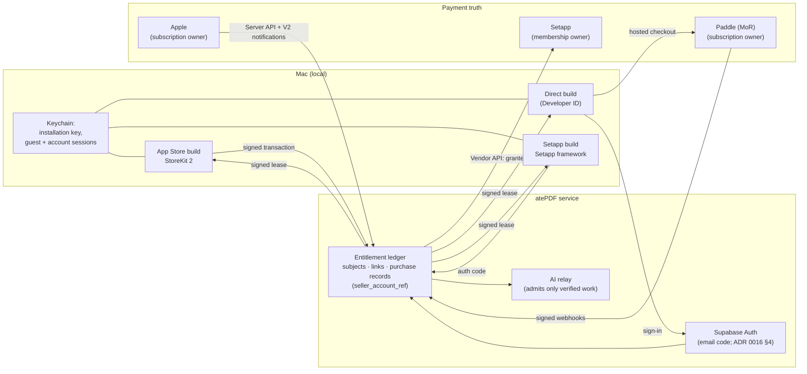

# ADR 0014 — Seller, direct payments and cross-channel account ownership (SHR-85)

**Status:** **Partially approved** by Shrey on 30 September 2026. **SELL-2 to SELL-10 are approved** (SELL-4 with a modification). **SELL-1 (legal seller) remains pending** owner facts, awaiting Apple and Setapp responses; only its architectural principle is approved (section 20). **Revision 2 (30 September 2026, owner-authorized cross-review corrections S85-01 to S85-03 and S85-O1 document corrections):** owner-authorized purchase relinking and recovery (section 10), unknown cross-channel ownership warnings (section 11), and the guest/installation identity now referencing the single lifecycle in ADR 0016 section 4 (SHR-79) instead of a separate relay secret (section 8). These correct the contract inside the approved SELL-2 to SELL-10 outcomes; they are not new owner decisions. **Independent-verification corrections (30 September 2026, owner-authorized, inside the same approved outcomes):** B1 and B2 mirrored from ADR 0016 section 4.3 (a revoked binding is final for its session; offline sign-out and bindings of vanished sessions; section 8, section 14 and cases I04/I05); N4 guest abuse controls no longer rely on Mac attestation (section 8); N6 source commit, the lost-Keychain recovery row (section 12) and first-link binding for never-linked App Store purchases (section 10, case R08). This is a commercial and account architecture decision. No company was incorporated, no developer or payment account was created or changed, no Terms were accepted, no product, price or checkout was configured and no transaction was made.  **Source:** `origin/main` `785397328a9871e013cb6b351881cc6507872b6f` (30 September 2026).  **Authority:** `PRODUCT_V1.md` D-01/D-07/D-08/D-09, BILL-01–10, DIST-01–06, OPEN-04, G-08; [SHR-85](https://linear.app/shrey-talwar/issue/SHR-85/decide-seller-direct-payments-and-cross-channel-account-ownership) (parent SHR-28); ADR 0011 (SHR-34, ENV-7 Setapp as an intended channel); ADR 0012 (SHR-35, H-09 relay-only identity, N-07 no device identifiers).  **Evidence:** [docs/evidence/SHR-85-2026-09-30](../evidence/SHR-85-2026-09-30/README.md) — machine-readable acceptance cases.

This ADR defines who sells atePDF, which systems hold the truth about who has paid, when a person needs an atePDF account, and how the three Mac channels (Mac App Store, direct download, Setapp) coexist without double charges or hostage files. It is the policy that SHR-86 (ledger), SHR-87 (StoreKit), SHR-88 (direct payments), SHR-89 (Mac paywall/integration) and SHR-91 (channel identities) implement or build on. It does not choose prices, allowance sizes or charging events (SHR-84), and it does not choose the AI service or relay provider (SHR-79, ADR 0016). Guest, installation, session and account-lifecycle mechanics are defined once in ADR 0016 section 4 and referenced here.

## 1. Summary of the decision

| Area | Decision |
|---|---|
| Seller (SELL-1) | **Pending** (awaiting Apple and Setapp responses). Principle approved: one long-term seller identity where practical; the long-term company if it exists and is ready before the first paid launch; an individual launch only after explicit owner approval; keep migration flexibility. The legal seller is not chosen until the section 3.4 facts are supplied. |
| Direct payments (SELL-2) | **Approved:** Paddle Billing as merchant of record, subject to actual eligibility and verification at signup. Polar only if Paddle onboarding or availability fails. |
| Accounts (SELL-3) | **Approved:** guest-first. No account to try atePDF or to buy in the App Store. An atePDF account is required for a direct purchase, for cross-channel entitlement linking and for restore/recovery where server identity is needed. No accounts in the Setapp build. Signup never grants another guest allowance. |
| Login (SELL-4) | **Approved with modification:** email one-time code is the required, common login for every supported channel. No passwords. Sign in with Apple is optional and deferred; v1 must not depend on it. Passkeys later. |
| Cross-channel (SELL-5) | **Approved:** App Store ↔ direct through a linked atePDF account, verified server-side, with channel-local fallback if App Review rejects it. Setapp is isolated in both directions. |
| Setapp (SELL-6) | **Approved:** Setapp build has no paywall, no upsell and no required atePDF account. Access is verified through the approved Setapp integration. |
| Devices (SELL-7) | **Approved:** no fixed device cap. Commercial limits are per account (SHR-84). Visible session list with remote sign-out. Family Sharing off. |
| Double subscription (SELL-8) | **Approved.** Server refuses to start a second paid subscription for an account that already has verified Pro. Paywalls show the active channel. Where ownership on another channel is unknown (including online, signed-in first use), warn before purchase; hard block only for known verified entitlement. |
| Restore (SELL-9) | **Approved.** Purchases are restored from the channel's own record (Apple, Paddle, Setapp) through the server ledger. Nothing depends only on local state. |
| Migration (SELL-10) | **Approved** as a light v1 requirement: seller-neutral identifiers and a seller field on every purchase record. Full corporate migration is not designed here. |

## 2. Current state

- `packages/commerce` holds disabled, provider-neutral synthetic contracts only (`COMMERCE_ENABLED = false`). `entitlement.ts` already uses an opaque `subject_<32 hex>` account reference and a monotonic `verificationRevision`. No verifier, account, seller, product or provider exists (`docs/COMMERCE_SANDBOX.md`, `docs/MONETIZATION.md`).
- No account system, login, installation identity or entitlement server exists.
- The historical build pack (`atepdf_codex_build_pack/growth/PAYWALL_AND_BILLING.md` §5) proposed optional account linking for store buyers and a recoverable account for web buyers. That is compatible with this ADR but was never an approved decision; its numeric benefits ("300 AI jobs") are not adopted.
- `PRODUCT_V1.md` names "Studio: Attenlo Labs". That is a studio name, not a confirmed legal entity. `DIST-05` says no incorporation or seller identity is presumed. This ADR keeps that position.

## 3. Seller options (Task 1)

### 3.1 What each channel needs from a seller

| Channel | Who contracts with the customer | Seller shown to the customer |
|---|---|---|
| Mac App Store | Apple acts as the developer's **agent or commissionaire** (DPLA Schedule 2 §1.1); the developer remains principal (§1.3); Apple invoices the customer (§1.2(e)) [A-DPLA] | The Apple Developer Program member: an individual's **legal name**, or an organisation's legal-entity name (no DBAs or trade names) [A-ENROLL] |
| Direct (merchant of record) | The MoR (Paddle) is the reseller to the customer [P1] | The MoR on the receipt; atePDF as the product |
| Setapp | Setapp sells the membership; the developer receives a usage share [SA-REV] | Setapp |

### 3.2 Options

| | **S-A: Shrey as individual** | **S-B: existing company** | **S-C: future Attenlo entity** |
|---|---|---|---|
| Available now? | Yes, if an Apple account in Shrey's name exists or can be enrolled | **Only if the owner confirms one exists** and it is appropriate to own atePDF. None is recorded in this repository. | **Unconfirmed.** No Attenlo legal entity is recorded; its formation, D-U-N-S and verification status await owner facts (section 3.4). If it is not formed and verified before launch, launch through it waits for that |
| Apple | Individual membership. Shrey's legal name is the public seller name [A-ENROLL] | Organisation membership: legal entity, D-U-N-S, domain email, website [A-ENROLL] | Same as S-B, once formed |
| Paddle | Sole traders are supported; identity check instead of business verification [P2] | Business verification | Business verification |
| Setapp | Vendor account terms are portal-only and **not verified** | Same | Same |
| Tax (high level) | Apple and Paddle handle consumer-side sales tax/VAT/GST in the storefronts they cover [A-DPLA][P1]. The seller still has income-tax and any local registration/filing duties on payouts in its country of residence. **Get professional advice; nothing here is tax advice.** | Same, at company level | Same |
| Later migration | **Apple:** conversion of an individual membership to an organisation can be **requested** if Shrey is founder/co-founder, with a D-U-N-S number; it is subject to Apple's verification and approval and is not guaranteed [A-CONVERT]. If approved, the apps stay in place. **Paddle:** each business needs its own account [P13]; moving subscribers to a new entity is **not documented as self-serve**. **Setapp:** unknown. | Moving from this company to another is an app transfer (Apple) plus a provider migration (Paddle) | No later migration if it is the first seller |
| Main cost | Personal name is public; later direct-subscriber migration | Commits atePDF to that company | Launch dependent on formation timeline |

### 3.3 Approved principle (SELL-1 itself pending)

Shrey approved this principle on 30 September 2026. It does **not** choose the legal seller.

- Use **one long-term seller identity** across the channels where practical, so receipts, support, refunds and the privacy policy name one party.
- **Prefer the long-term company** if it exists and is ready (formed, verified, D-U-N-S) before the first paid launch.
- **An individual launch (S-A) may be used only after explicit owner approval.** It is not a default. If approved, a later Apple individual-to-organisation conversion can be requested, subject to Apple's verification and approval; it is not guaranteed [A-CONVERT]. The direct channel carries the migration cost, so any migration should happen while the direct subscriber base is small.
- **Preserve migration flexibility** (SELL-10, section 16).
- "Attenlo Labs" must not appear as the legal seller unless it is a legal entity.

### 3.4 Facts that require owner confirmation (blockers, not assumptions)

1. Country of tax residence of the intended seller (India, UAE or other).
2. Whether any company already exists that should own atePDF, and its country.
3. Whether an Apple Developer Program membership already exists, and whether it is Individual or Organization, and in whose name.
4. Whether and when an Attenlo legal entity is planned, and whether a D-U-N-S number exists.
5. The payout bank account's country and currency.
6. Whether Shrey accepts his personal legal name being shown as the App Store seller (S-A).

None of these were looked up, guessed or taken from credentials. **Status: pending, awaiting Apple and Setapp responses.** No fact above is assumed anywhere in this ADR.

## 4. App Store baseline (Task 2)

All Apple facts are from primary Apple documentation accessed 30 September 2026 (section 19). Recheck at SHR-87 implementation and submission (DIST-06).

| Topic | Baseline |
|---|---|
| Purchase identity | The customer's Apple Account. StoreKit 2 signed (JWS) `Transaction`s; `originalTransactionId` identifies the subscription. `verifyReceipt` is deprecated; use `AppTransaction`/`Transaction` JWS, the App Store Server API and Server Notifications V2 [A-RECEIPT] |
| atePDF association | Set `appAccountToken` (a UUID) at purchase [A-AAT]. atePDF uses a **random per-subject purchase token**, not the account ID. The server-side *Set App Account Token* endpoint can set or replace it for current and future renewals, not past transactions, and not for Family Shared transactions [A-SETAAT] |
| Entitlement owner | **Apple** owns the subscription state. atePDF's server keeps a **verified mirror** (signed transactions, `Get All Subscription Statuses`, V2 notifications including `SUBSCRIBED`, `DID_RENEW`, `DID_FAIL_TO_RENEW`, `GRACE_PERIOD_EXPIRED`, `EXPIRED`, `REFUND`, `REFUND_REVERSED`, `REVOKE`) [A-NOTIF] |
| Restore | `Transaction.currentEntitlements` returns active/grace subscriptions, excluding refunded/revoked [A-CE]. `AppStore.sync()` shows a sign-in prompt, so call it **only** from an explicit Restore Purchases button [A-SYNC]. Guideline 3.1.1 says apps **should** provide a restore mechanism; atePDF will |
| Family Sharing | Per product, and **cannot be turned off once enabled** [A-FAMILY]. **Off** for v1 (SELL-7, approved) |
| Subscription management | `showManageSubscriptions`/`manageSubscriptionsSheet` are **not supported on macOS**; Apple says to avoid them in Mac Catalyst [A-MANAGE]. The Store build opens the App Store subscriptions page instead (exact URL verified in SHR-87) |
| Refunds | Apple issues them; the developer may not (DPLA Attachment 2 §3.4) [A-DPLA]. `beginRefundRequest(in:)` is available on Mac Catalyst 15+ [A-REFUND]; otherwise reportaproblem.apple.com [A-SUPPORT] |
| Commission | 30% standard, 15% on subscription renewals after one year; 15% from day one in the Small Business Program (≤ $1M proceeds in the prior year) [A-DPLA][A-SBP]. Sourced estimate; verify at enrolment |
| Recognising purchases made elsewhere | Guideline 3.1.3(b) (Multiplatform Services) allows access to subscriptions bought on the developer's website **provided those items are also available as in-app purchases** [A-GUIDE]. atePDF's Store build therefore always sells Pro through StoreKit too |
| Steering | Outside the US storefront, the app may not include buttons, links or calls to action to other purchase methods (3.1.1, 3.1.3) [A-GUIDE]. The US storefront changes of 1 May 2025 [A-US] and the EU macOS terms effective 1 October 2026 (DPLA Attachment 14) [A-DMA] are **not adopted for v1**: they need separate terms, entitlements and review, and would split behaviour by storefront |
| Developer ID builds | Apple's macOS capability table lists In-App Purchase as **App Store-only** [A-CAP]. The direct build cannot use StoreKit; it needs its own payment provider. The same table lists Sign in with Apple as unavailable with Developer ID; whether another Sign in with Apple route is viable for the direct build is **unverified** and left to SHR-91 (SELL-4). No Apple rule restricting third-party payment in Developer ID apps was found (absence of evidence) |

**What this means.** The App Store build can *honour* a direct purchase but can never *sell* or point to one outside the US/EU exceptions. An App Store purchase is visible to other builds only through atePDF's own server ledger, never through StoreKit.

## 5. Direct payment options (Task 3)

Fees are **sourced estimates from the providers' own pages on 30 September 2026; verify at signup**. Full sources in section 19.

| | **Paddle Billing** | **Stripe Billing + Tax** | **Stripe Managed Payments** | **Lemon Squeezy** | **Polar** |
|---|---|---|---|---|---|
| Role | MoR: Paddle is the reseller [P1] | Processor: **atePDF is the merchant** and must register/remit VAT/GST itself [S3] | MoR (Stripe, via Link) [S5] | MoR [L6] | MoR [PO1] |
| Individual seller | Yes (sole trader) [P2] | Yes [S10] | Stripe eligibility review [S4] | Not stated | Yes, where Stripe Connect Express supports it [PO1] |
| India-based seller | Not on unsupported list [P3] | **Invite-only** [S7] | **Not eligible** [S4] | Bank payouts need Stripe India; else PayPal [L3] | Listed [PO1] |
| UAE-based seller | Not on unsupported list [P3] | Available [S8] | **Not eligible** [S4] | Listed [L3] | Listed [PO1] |
| Headline fee | 5% + 50¢ per checkout transaction [P4] | IN: 3% intl cards (+2% FX) + Billing 0.7%; AE: 2.9% + AED 1 (+1% intl, +1% FX) + Billing 0.7% + Tax 0.5% [S1][S2] | 3.5% on top of processing and Billing [S6] | 5% + 50¢, +1.5% intl, +0.5% subscriptions [L1] | 5% + 50¢, +1.5% intl cards [PO2] |
| Subscriptions, trials, proration, dunning | Yes [P10] | Yes [S13] | Yes | Yes | Yes |
| Signed webhooks | HMAC-SHA256 `Paddle-Signature` [P11] | `Stripe-Signature` [S14] | Same | `X-Signature` [L10] | Yes |
| Customer portal | Hosted: update card, cancel [P10] | Yes [S13] | Link / portal [S5] | Yes [L9] | Yes |
| Refunds | Paddle has final discretion; statutory windows [P6] | Seller decides | Stripe may refund [S5] | Seller policy; LS may refund to prevent chargebacks [L4] | Seller |
| Chargebacks | Paddle handles; $20 fee [P5] | Seller handles | Stripe handles [S5] | $15 [L4] | $15 [PO2] |
| Payouts | Monthly, $100 min, wire/Payoneer [P7] | Standard Stripe | Standard Stripe | Twice monthly, $50 min [L2] | Connect Express fees [PO2] |
| Portability | Card data to a new PCI vault "within 2 weeks" [P8] | PAN export to a PCI Level 1 processor, **Link-saved cards excluded** [S11] | Link-based; likely lock-in (unverified) | Subscription CSV; card export undocumented [L7] | Not researched |
| Status risk | — | — | Not open to IN/AE sellers | Owner's 2026 post: slower support, migration path to Stripe Managed Payments [L8] | Newer provider |
| Mac-software/AI policy | Compatible as far as the AUP shows (PDF tool not a prohibited category; inference) [P12] | Compatible [S15] | AI tax codes eligible [S4] | No conflict found [L11] | Not researched |

**Approved: Paddle Billing (SELL-2)**, subject to actual eligibility and verification at signup.
- It is the only mature MoR that is open to both candidate seller locations, individual or company.
- MoR means no per-country VAT/GST registration for a solo founder.
- It handles chargebacks and has the clearest documented card-portability promise, which matters for SELL-10.
- It has a hosted customer portal, so atePDF does not build billing management.
- Limitation: Paddle Billing has **no native license keys** and its Mac SDK is Classic-only [P9]. atePDF does not need either: the atePDF account plus the server ledger **is** the licence. The Paddle page also notes products under $10 need custom pricing [P4]; check against SHR-84 prices.
- **Fallback:** Polar, only if Paddle onboarding or availability fails. **Not recommended:** plain Stripe (seller becomes merchant and owns global tax compliance; India invite-only), Stripe Managed Payments (not available to India/UAE sellers), Lemon Squeezy (declared reduced investment and migration toward Stripe Managed Payments).
- Paddle's refund discretion means atePDF's own direct refund policy sits inside Paddle's buyer policy, not above it.

## 6. Setapp (Task 4)

Facts from public docs.setapp.com pages and Setapp support, accessed 30 September 2026. Portal-only terms were not read. **No Setapp acceptance is claimed**; verification remains SHR-91.

| Topic | Fact / policy |
|---|---|
| Build | Separate build with bundle ID `<…>-setapp`, fixed once set [SA-BUNDLE]. Developer ID signed, notarised, Universal, Catalyst supported [SA-PREP]. Setapp delivers updates; Sparkle must be removed [SA-FAQ] |
| Not allowed in the Setapp build | Paid features, licensing/activation, built-in stores and in-app purchases, charging Setapp users on top of their membership, cross-promotion [SA-PREP][SA-GUIDE] |
| Entitlement source | **Setapp.** On macOS the Setapp launch agent controls whether the app runs [SA-SUB] |
| Server-side verification | Setapp **Vendor API** (OAuth 2.0). The app requests an authorisation code (`applicationAccess` scope); **only the atePDF server** exchanges it; `POST /resource/v1/application/access` returns `granted`. The JWT `sub` is the Setapp user ID. Setapp recommends checking each session and at least every 24 h [SA-VENDOR] |
| atePDF account in the Setapp build | Not forbidden outright, but guideline 7.3 rejects apps that collect contact information by custom methods instead of Setapp's tools [SA-GUIDE]. **Unverified;** v1 avoids it |
| Subscription ends | Apps stay installed but cannot be used [SA-CANCEL] |
| Existing buyers | No cross-grant; Setapp tells users to cancel their App Store/direct subscription themselves [SA-SWITCH] |
| Revenue | 70% of each member's fee split by apps used, weighted by a price tier set from the annual price outside Setapp. Setapp's public tier document says an outside price is **typically** considered once it has been in effect for about 3 months [SA-REV]; this is not an unconditional launch rule, and the actual tiering for atePDF needs Setapp's confirmation (SHR-91) |
| Setapp AI Gateway | OpenAI-compatible proxy using the user's Setapp AI credits [SA-AI]. **Not adopted in v1:** it is a different AI recipient that needs its own SHR-79 (ADR 0016)/ADR 0012 disclosure record |

**Setapp policy (SELL-6, approved).**
1. The Setapp build shows **no paywall, price, purchase, restore-purchase, external/direct upsell or required atePDF sign-in**. v1 offers no atePDF sign-in there at all (guideline 7.3 risk).
2. At launch it obtains a Vendor API authorisation code and sends it to the atePDF server. The server exchanges it, checks `granted`, and creates or finds a `subject` keyed by the Setapp `sub`. The client never asserts Setapp status.
3. An active Setapp member gets the **Pro service level** under a Setapp-specific allowance defined in SHR-84, because Setapp forbids charging on top of the membership. At that limit, atePDF says when it resets and does **not** upsell.
4. Setapp access is not recognised in the App Store or direct builds, and App Store/direct purchases are not recognised in the Setapp build (section 9).
5. If Setapp access ends, hosted AI stops at the server on the next check (`granted=false`) and the Setapp agent stops the app.
6. **Open release gate owned by SHR-91 (BILL-04):** BILL-04 requires continued access to existing originals/results, previews, recovery/Undo, deletion, privacy settings and subscription management after expiry, but Setapp stops the whole app when membership ends [SA-CANCEL]. Files the user already saved or exported in Finder, or a documented location of the encrypted workspace container, are only a subset of that and are **not** proof of full recovery. SHR-91 owns a usable channel/recovery solution and its evidence before any Setapp release. Only Shrey can grant a product exception or decide to defer the channel; **no exception is granted here** (awaiting Apple and Setapp responses).
7. Hosted-AI cost for Setapp users is paid from the usage share. SHR-84 must size the Setapp allowance with that in mind.
8. Setapp **typically** considers an outside price for tiering after it has been in effect for about 3 months [SA-REV]. Whether and when atePDF can be tiered, and whether this affects launch timing, requires Setapp's confirmation in SHR-91; it is not treated as an unconditional launch ban.

## 7. Account requirement (Task 5)

**Approved: A with one condition (SELL-3).**

| Situation | Account? |
|---|---|
| Trying atePDF, using the guest allowance | **No** (BILL-01, UX-01) |
| Buying Pro in the App Store build | **No.** The Apple Account is the purchase identity |
| Buying Pro in the direct build | **Yes, at checkout** (email code). A direct purchase needs a recoverable, verifiable owner; an anonymous direct subscription could not be restored on a new Mac |
| Restore/recovery that needs server identity (for example, a direct purchase on a new Mac, or recovering a linked cross-channel entitlement) | **Yes** (sign in) |
| Using a direct purchase in the App Store build, or an App Store purchase in the direct build | **Yes** (sign in to link) |
| Pro on several Macs in the same channel | App Store: no (same Apple Account). Direct: yes (sign in) |
| Setapp build | **No accounts** |

- **Signing up never grants allowance.** Linking a guest to an account keeps the **lower** remaining guest allowance of the two; creating a second account does not create a second allowance on the same installation (section 8).
- An App Store purchase stays valid without an account. Linking is offered after purchase ("Use Pro in the direct download too"), never required.
- **App Review 5.1.1(v):** if the Store build lets people create an account, it must offer in-app account deletion [A-GUIDE]. Both builds offer it (section 14).

Rejected: **B (account required for every purchase)** — adds friction to the App Store purchase for no entitlement benefit, and 5.1.1(v) discourages forced login when features are not account-based. **C (no accounts at all)** — makes direct purchases unrecoverable on a new Mac and rules out cross-channel access.

## 8. Guest installation identity (Task 6)

**One interface, defined in ADR 0016 section 4 (SHR-79).** This ADR uses that Supabase-backed installation/account lifecycle and defines **no second relay authentication scheme**. The earlier draft's relay-issued `installation_<id>` authenticated by a 256-bit installation secret is withdrawn. Bound by ADR 0012 H-09 and N-07.

- **Identity.** At first hosted use the Mac generates a random `inst_<32 hex>` installation ID and a P-256 **installation key**, and signs in as a Supabase **anonymous** user (the guest principal). The server creates the installation and its guest `subject_<32 hex>`. The guest subject belongs to the installation, not to any Auth user (ADR 0016 sections 4.1–4.2).
- **Credentials and custody** (identical in both ADRs because they are defined only in ADR 0016 section 4.1 and 4.3): the guest session and any account session are kept in the Keychain (this device only, not synced) under separate storage keys; the private installation key stays in the Keychain and is never sent anywhere. The Mac proves the installation only by signing a single-use server challenge at registration, account linking, guest re-binding and key rotation; the key is rotated on every re-binding. Only the Supabase publishable key is in the app; no privileged key. Nothing here is sent to the model provider or to analytics.
- **Relay authentication** is the Supabase access token plus a live-session and installation-binding check on every admission, failing closed if revocation state is unavailable (ADR 0016 section 4.4).
- **No fingerprinting.** No hardware serial, MAC address, IOPlatformUUID, device name, advertising ID or derived hash (N-07, BILL-06).
- **Registration never tops up allowance.** One installation per guest principal and one registration per installation ID; a new allowance appears only for a genuinely new installation, under the global new-guest cap (ADR 0016 section 4.3 step 1).
- **Reinstall.** macOS keeps Keychain items when an app is deleted, so a reinstall on the same macOS user normally keeps the same installation, guest subject and any valid account session. This is platform behaviour, not a guarantee (to be verified on device).
- **Reset.** If the Keychain items are removed (new macOS user, erased Mac, manual deletion), the app is a new guest. This is the accepted imperfection of anonymous use (BILL-06). Abuse control is server-side: rate limits per network, new-guest creation velocity, and DeviceCheck only if an on-device test succeeds and the owner adds Apple as a recipient (App Attest is unavailable on Mac; ADR 0016 section 4.6). Not fingerprinting.
- **Channel builds.** Whether the Store, direct and Setapp builds on one Mac share a guest depends on a shared Keychain access group under one Team ID. SHR-91 decides. **Do not use an App Group container shared across Mac apps for this**: Apple cannot transfer sandboxed Mac apps that share an App Group container [A-TRANSFER] (SELL-10).
- **Relationship to accounts** (ADR 0016 section 4.3). Signing in (email one-time code) creates or uses a **separate** account user and links the installation to it; the anonymous guest principal is never converted into the account. Guest usage consumed on the installation stays consumed. **Signing out** returns the installation, authenticated by its retained guest session, to its **original** guest subject with its already-consumed allowance, without the account's paid authority and without a new allowance. **Remote sign-out** of one installation or of all installations, and **account deletion**, revoke the affected account bindings server-side at once; each affected installation falls back to its own guest subject, whose consumed-allowance record survives account deletion. A revoked binding is final for its Supabase session: `link_installation` refuses (`401 session_revoked`) any session that has a revoked binding, so a signed-out installation regains account access only through a fresh email one-time code, a new session (ADR 0016 section 4.3 step 5, case S62). **Offline sign-out** stops using the account session at once but keeps it in the Keychain marked sign-out-pending; at the next contact the Mac completes the server sign-out with it before any guest request. An account binding whose session no longer exists counts as revoked, so a guest request is never refused because of it (ADR 0016 section 4.3 step 4, case S70).
- **Privacy.** The server stores installation ID, installation public key, subject, session bindings, created/last-seen time, channel and app version. No document data, device name or IP address beyond short-lived processor logs, whose retention SHR-95 publishes.

**Shared lifecycle cases.** I01–I07 in section 18 each name the ADR 0016 case that tests the same step, so both contracts are exercised by one sequence.

## 9. Purchase ownership and the entitlement ledger (Task 7)

**A server entitlement ledger is necessary** and is already required by BILL-06 for hosted metering. The client never self-asserts paid state.

| Access | Source of truth | Server evidence | How the app learns |
|---|---|---|---|
| App Store Pro | **Apple** | Signed JWS transaction verified server-side; App Store Server API; V2 notifications; `originalTransactionId` + `appAccountToken` | Server entitlement response; StoreKit `currentEntitlements` for offline display only |
| Direct Pro | **Paddle** (MoR) | Signed webhooks + Paddle API reconciliation; Paddle customer/subscription IDs; `custom_data` = opaque purchase token | Server entitlement response |
| Setapp access | **Setapp** | Vendor API `granted` for `sub`, rechecked ≤ 24 h | Server entitlement response |
| Guest allowance | **atePDF server** | Ledger (SHR-86, rules from SHR-84) | Server allowance response |

**Ledger model (contract for SHR-86).**
- `subject` — opaque `subject_<32 hex>` (matches `packages/commerce`). One per guest installation, per atePDF account and per Setapp user.
- `principal` — something that authenticates to a subject: the installation's guest session (anonymous Supabase user, backed by the installation key), an account session (verified email, email one-time code), the Setapp `sub`. Principals and their sessions are defined in ADR 0016 section 4.
- `purchase_record` — `{channel: app_store|direct|setapp, seller_account_ref, provider, external_id, product: pro_monthly|pro_annual|setapp_membership, status, period_end, verification_revision}`. **Every record carries `seller_account_ref`** (section 16).
- `link` — a purchase record belongs to exactly one subject at a time. Moving it to another subject is an explicit, logged re-link, never a copy.
- **Effective entitlement** = the server's union of verified active/grace records linked to the subject. The relay admits paid work only against it.
- **Offline.** The server issues a short-lived signed entitlement lease (subject, service level, `not_after`). `not_after` never exceeds the verified period end plus the approved grace. The lease length and offline allowance behaviour are SHR-84/86 parameters, not set here.

## 10. Cross-channel access (Task 8)

"Recognised" means: same atePDF subject **and** a verified active record on the server **and** the channel's rules permit it. Nothing is promised beyond this table (DIST-04).

| From → to | v1 policy | How | Why / limit |
|---|---|---|---|
| App Store → App Store on another Mac | **Supported** | Same Apple Account; StoreKit; Restore button | Native Apple behaviour |
| App Store → direct build | **Supported with account link** | In the Store build, the user signs in; the app sends its current signed transaction; the server verifies it with Apple and links `originalTransactionId` to the account. The direct build then sees Pro | Apple owns the subscription; atePDF only recognises it |
| Direct → App Store build | **Supported with sign-in** | Store build sign-in; server reports Pro | Guideline 3.1.3(b): allowed because Pro is also sold as IAP in the Store build [A-GUIDE]. The Store build shows **no** direct price, link or call to action. **Review risk:** if Apple rejects this, fall back to channel-local for the Store build; the direct purchase is unaffected |
| Direct → direct on another Mac | **Supported** | Sign in | — |
| Setapp → App Store/direct | **Not supported** | — | Setapp membership is Setapp's product; no cross-grant exists [SA-SWITCH] |
| App Store/direct → Setapp build | **Not applicable** | — | Setapp build has no paywall and no account; an active Setapp member already has access. The user may cancel their other subscription at its owner |

**Linking rules.**
- One `originalTransactionId` or Paddle subscription links to **one subject at a time**. First linking of an unlinked purchase needs the claimant's signed-in account (email one-time code) **and** verified channel evidence that the purchase is valid (server-verified Apple JWS / App Store Server API, or Paddle webhook/API state). For a never-linked App Store purchase a verified JWS alone is not enough, because a signed transaction can be forwarded and first-linked by someone else: SHR-87 binds the first link to a matching `appAccountToken` (the purchase token issued to the claimant's subject) or to fresh on-device StoreKit proof from the Store build signed in to the purchasing Apple Account (R08).
- **A purchase already linked to another account is never moved on the claimant's say-so.** Channel evidence proves that a purchase exists and is valid; it does not prove that the claimant owns it. Proving control of the destination account (its email code) proves control of that account only. A move from account A to account B happens only through one of:
  1. **Current-owner authorization:** account A, signed in with a fresh email one-time code, explicitly authorizes the transfer of that purchase to B, and B accepts while signed in; or
  2. **Verified channel-owner recovery** (section 12): fresh owner-bound channel proof plus a documented support identity and authorization check.
- **Never sufficient on their own:** a receipt or screenshot, an order ID, a transaction ID, a forwarded or replayed signed transaction, or an email code for the destination account.
- The move is one atomic ledger transaction under a lock on the purchase record: it succeeds only if the purchase is still linked to the subject the authorization named, so concurrent attempts produce **exactly one** authorized link (R06). It moves the link, never copies the entitlement, and never grants, resets or transfers allowance (D-07, SELL-3).
- **After** authorization, both accounts are notified by email and an audit record `{purchase, from_subject, to_subject, method, support_case (if any), authorized_at}` is kept (retention: SHR-95). Notification is a consequence of an authorized move, never its authorization.
- Family-shared transactions are never linkable (Family Sharing is off anyway).
- Signing out removes cross-channel access on that installation; channel-native access (StoreKit in the Store build) remains.

## 11. Double-subscription prevention (Task 9)

**SELL-8 policy (approved).**
1. **Show before selling.** Every paywall first asks the server for the subject's entitlement. If Pro is active, it shows "You have atePDF Pro through {App Store | direct | Setapp}. Manage it there." with the correct management route (section 13) instead of a buy button.
2. **Direct: hard block for known entitlement only.** The server refuses to create a Paddle checkout for an account whose ledger already has a **verified** active Pro linked to it, from any channel (X01, X09). Checkout requires sign-in first, so the server always knows the account. This blocks only what the ledger knows; it cannot see purchases that were never linked (rule 5).
3. **App Store: native check first.** The Store build checks `Transaction.currentEntitlements` before showing the purchase button. If this Apple Account already has Pro, it offers Restore, not Buy. StoreKit itself prevents two active subscriptions in one subscription group for one Apple Account.
4. **App Store: account check.** If the Store build is signed in and the account has direct Pro, the buy button is replaced by the "already Pro" message. atePDF cannot technically block an Apple purchase made from the Store app, so this is UX, not enforcement.
5. **Unknown ownership on other channels: warn, do not block.** Because an App Store purchase needs no atePDF account (SELL-3), the server cannot discover purchases that were never linked, even for an online, signed-in account on a new Mac. So whenever the server reports **no known entitlement** — including online, signed-in, first-use and new-Mac direct checkout — and whenever status cannot be confirmed (offline, or signed out while a Keychain hint shows an earlier sign-in), the paywall shows before any purchase: "If you already subscribe another way, sign in or restore first." It offers the existing routes (sign in to the account used before; in the Store build, Restore Purchases and link; for an App Store purchase used in the direct build, link it from the Store build) and still lets the user buy (X04, X07, X08). In the Store build the warning names no direct price, link or other purchase method (section 4, steering). atePDF does **not** claim universal duplicate prevention: a person who ignores the warning can hold two subscriptions, which rule 6 then surfaces. An App Store purchase still requires no atePDF account (X11).
6. **Detection after the fact.** If the ledger finds two active paid records on one subject, the app shows both and the management route for each. For direct, atePDF's refund policy (SELL-2 follow-up) should cover the overlap. App Store refunds remain Apple's decision.
7. **Setapp.** No detection is possible without accounts, and none is attempted: Setapp access never blocks or is claimed by the Store or direct paywall, and vice versa (X10). The direct/Store paywall FAQ and the Setapp build's About box explain that Setapp and other subscriptions are separate.

## 12. Restore and recovery (Task 10)

Purchase recovery never depends only on local state.

| Case | Recovery path |
|---|---|
| Reinstall, same Mac and macOS user | Keychain items (installation key, guest session, any account session; ADR 0016 section 4.3 step 8) usually survive; guest and sign-in restore silently. A session revoked meanwhile falls back to the guest. If not: App Store → StoreKit updates / Restore; direct → sign in; Setapp → launch through Setapp |
| New Mac | App Store: same Apple Account + Restore. Direct: sign in by email code. Setapp: sign in to Setapp. The guest allowance does **not** move (new guest, no free top-up beyond what one new installation gets — SHR-84 decides whether any) |
| Lost Keychain items (installation key) | New guest. Purchases are unaffected because they live at Apple/Paddle/Setapp and in the server ledger. A lost guest session with the installation key still present is not this case: it re-binds to the same guest subject (ADR 0016 section 4.3 step 7) |
| App Store restore | Restore button → `AppStore.sync()` → server verifies transactions → re-link to the account if one is signed in |
| Direct account restore | Email code sign-in → server ledger → Paddle record |
| Setapp reinstall | Setapp installs; Vendor API → `granted` |
| Lost email access | **Support-assisted verified channel-owner recovery only.** Required together: (a) the claimant signs in to a **new** destination account by email code (proves only the destination); (b) **fresh owner-bound channel proof** produced during the recovery for the purchasing customer itself — for Paddle, confirmation obtained by support from Paddle that the claimant passed Paddle's own customer verification for that subscription (method to be confirmed with Paddle in SHR-88); for Apple, proof produced during the recovery by the Store build from StoreKit while signed in to the purchasing Apple Account, with a freshness binding that SHR-87 must define and verify (an earlier or forwarded signed transaction does not qualify; channel-native Restore in the Store build keeps working regardless); and (c) a **documented support identity and authorization check** recorded in the audit trail. A receipt screenshot, order ID, transaction ID, forwarded signed transaction or destination email code alone is refused (R01–R03). Until the SHR-87/88 procedures exist and are verified, no recovery relink is performed and the purchase stays where it is. After authorization the purchase moves atomically (section 10), the old address is notified, and no entitlement is copied and no allowance reset. No self-serve email change without access to the old address in v1 |
| App Store buyer who never linked | Nothing to recover at atePDF; Apple restores it in the Store build |

## 13. Refunds, cancellations and management (Task 13)

| Channel | Cancel / manage | Refund owner | In-app route |
|---|---|---|---|
| App Store | Apple (App Store subscriptions page) | **Apple** (atePDF cannot refund) | "Manage subscription" opens the App Store subscriptions page; "Request a refund" uses `beginRefundRequest` (Mac Catalyst 15+) or reportaproblem.apple.com |
| Direct | Paddle customer portal | **Paddle** as MoR, under atePDF's stated direct refund policy within Paddle's buyer policy | "Manage subscription" asks the server for a portal session URL; "Refund" links to the policy and support |
| Setapp | Setapp account | **Setapp** | About/Help text: "Your access comes from Setapp. Manage it in Setapp." |

- The app shows only the route for the channel that actually owns the active record.
- The direct refund window (for example, "within N days of first payment") is **not chosen here**. It is an owner decision to be recorded with SHR-84's refund rules before SHR-88.
- Cancelling never deletes files, results or the account. Deleting the account never silently leaves a direct renewal running (section 14).

## 14. Login, account deletion and sessions (Task 12)

| Option | Fits App Store + direct? | Burden | Verdict |
|---|---|---|---|
| **Email one-time code** | Yes, in every channel; atePDF's own sign-in is exempt from guideline 4.8 [A-GUIDE] | Low: send and verify a code, rate-limit | **Required v1 login (SELL-4)** |
| Magic link | Yes | Needs link return into a sandboxed and a Developer ID app; mail scanners can pre-open links | Not in v1 |
| Sign in with Apple | Unverified for the direct build: Apple's capability table lists it as unavailable with Developer ID [A-CAP], but other routes are not assessed. Hidden relay emails do not match Paddle receipt emails | Medium | **Optional, deferred.** SHR-91 may verify viability across the final signing and identity setup. v1 must not depend on it |
| Email + password | Yes | Password storage, reset, breach handling | Rejected |
| Passkeys | Later, once an account exists | Medium | Later |

- **SELL-4 as approved:** email one-time code is the required, common login method for every supported channel. No passwords. Sign in with Apple is optional and deferred; SHR-91 may verify whether it is viable across the final App Store/direct signing and identity setup; v1 must not depend on it. This keeps the account architecture channel-neutral.
- Codes: short-lived, single-use, rate-limited per email and per installation. The session refresh token lives in the Keychain.
- **Build or buy** of the code-sending/identity piece: SHR-79 chose Supabase Auth (ADR 0016 AI-1/AI-5; email one-time code in its section 4.5, with a custom SMTP provider and its recipient record before email sign-in ships). The requirement stays small: no passwords, and no dependency on any social or platform login.
- **Account deletion** is available in-app in the Store and direct builds (5.1.1(v)). It deletes the account and links. It **cancels a direct renewal at Paddle** (with a clear statement that no refund is implied). It tells App Store users that their Apple subscription continues until they cancel it with Apple. Local files are untouched.
- **Sessions:** Settings lists signed-in installations by channel, app version and last-seen date. It shows no device names (N-07). The user can sign any one of them out, or all of them. Revocation is enforced server-side at the next hosted request, not at token expiry, while the account's other sessions keep working; each signed-out installation returns to its own guest subject (ADR 0016 sections 4.3–4.4). A revoked binding is final for its session: a signed-out installation regains account access only through a fresh email one-time code (ADR 0016 section 4.3 step 5).
- **Account deletion and identity records** follow ADR 0016 section 4.3 step 6: account sessions are revoked at once; installation and guest-allowance records survive so deletion never creates a new guest allowance; the Supabase admin key lives only in a separate server path, never in the app.

## 15. Device policy (Task 11)

**SELL-7 approved: no fixed device cap in v1.** No device-count policy is promised unless later evidence requires one.
- Hosted cost is metered **per subject** (SHR-84 Pro limits). Sharing an account spreads one allowance; it does not multiply cost. A device count would add friction without protecting cost.
- A normal user with a desktop and a laptop is not blocked or asked to deauthorise anything.
- **Abuse controls** are server-side: per-subject rate and concurrency limits, and review of anomalous patterns (for example, many simultaneous sessions from unrelated networks). They are safety/abuse controls, not commercial device limits, and never say "upgrade" (BILL-07).
- **Offline** use follows the signed lease (section 9).
- **Privacy:** no hardware identifiers; sessions are installation IDs only.
- **Family Sharing: off** for v1. It cannot be turned off later [A-FAMILY]; each family member would draw on hosted AI; family-shared transactions cannot carry an app account token [A-SETAAT].
- Setapp's own device limits (for example, one Mac on the Mac plan [SA-PRICE]) are Setapp's.
- A numeric cap may be added later only with measured abuse evidence and owner approval.

## 16. Migration (Task 15)

Full corporate migration is not designed here. The v1 architecture avoids binding users to a seller:

1. **Seller-neutral user identity.** A user's atePDF account is an email + `subject`, with no seller ID in it. Changing seller never changes a user's account.
2. **Seller on every purchase record** (`seller_account_ref`), so two sellers' records can coexist during a changeover.
3. **Seller-neutral product and bundle identifiers.** No personal names in bundle IDs, StoreKit product IDs, Paddle product names or Keychain groups. Final IDs are chosen in SHR-91/87/88.
4. **Apple:** prefer requesting conversion of an individual membership to an organisation (apps stay in place if Apple approves; subject to Apple's verification, not guaranteed) [A-CONVERT] over an app transfer. If a transfer is ever needed: no App Group container shared with another Mac app, keep IAP product IDs unique, and if Sign in with Apple is ever adopted, plan for its per-user transfer identifiers [A-TRANSFER]. Whether active subscriptions survive a transfer uninterrupted is **unverified**.
5. **Paddle:** each legal entity has its own Paddle account [P13]; moving subscribers means migrating card data under Paddle's portability commitment [P8] and re-creating subscriptions. Keep direct subscriber count and complexity low before any change.
6. **Setapp:** vendor-account change process unknown; verify before signing.

**SELL-10 approved:** light seller-migration flexibility is a v1 architectural requirement: seller-neutral internal user/account/entitlement identifiers; an explicit seller and channel field on every purchase record; external provider transaction IDs kept separately from internal IDs; no schema that makes a future Apple app transfer or payment-provider migration unnecessarily impossible. Items 1–4 apply now. Items 5–6 are documented risks. No migration system is built now.

## 17. Commercial responsibility matrix (Task 14)

| Channel | Seller | Payment processor | Entitlement source | Account required? | Restore owner | Refund owner | Subscription management | App entitlement verification |
|---|---|---|---|---|---|---|---|---|
| Mac App Store | SELL-1 seller (Apple as agent/commissionaire) | Apple | Apple (StoreKit) | No (optional link) | Apple via StoreKit; atePDF ledger for cross-channel | Apple | App Store subscriptions page | Server verifies JWS + App Store Server API + V2 notifications; client StoreKit for offline display only |
| Direct download | Paddle as MoR; SELL-1 seller as vendor | Paddle | Paddle | **Yes, at purchase** | atePDF account (email code) + Paddle record | Paddle, under atePDF direct refund policy | Paddle customer portal | Server verifies signed Paddle webhooks + API reconciliation |
| Setapp | Setapp | Setapp | Setapp | No (no atePDF account) | Setapp | Setapp | Setapp account | Server exchanges Vendor API code; `granted` for `sub`, rechecked ≤ 24 h |
| Guest (any non-Setapp build) | — | — | atePDF server ledger | No | Keychain installation key and guest session (ADR 0016 §4); otherwise new guest | — | — | Server ledger; Supabase session + live session/installation binding check at the relay (ADR 0016 §4.4) |

## 18. Acceptance cases

Machine-readable: [`seller-account-cases.json`](../evidence/SHR-85-2026-09-30/seller-account-cases.json). These are policy cases for SHR-86/87/88/89 tests. They are not evidence that anything works.

| ID | Situation | Expected |
|---|---|---|
| G01 | New guest, no account, starts work | Admitted against guest allowance; no signup prompt |
| G02 | Guest exhausts allowance, then creates an account | Still exhausted; no top-up |
| G03 | Guest A (3 left) signs into account whose guest pool has 1 left | 1 left (lower value kept) |
| G04 | Signed-in user signs out | Installation returns, authenticated by its retained guest session, to its original guest subject with its consumed allowance; no account paid authority; no new allowance (ADR 0016 S70) |
| G05 | App deleted and reinstalled, Keychain items present | Same installation and guest subject (ADR 0016 S73) |
| G06 | Keychain items removed | New installation and guest subject under the global new-guest cap; no purchase lost (ADR 0016 S73) |
| G07 | Client sends `pro=true` without server evidence | Rejected; relay admits nothing paid |
| A01 | App Store purchase, no account | Pro in the Store build via verified JWS; no account prompt |
| A02 | App Store Pro, same Apple Account, second Mac, Restore | Pro restored; `AppStore.sync()` only after the button |
| A03 | App Store Pro, user signs in and links, opens direct build | Pro recognised in direct build |
| A04 | App Store Pro linked; Apple sends `REFUND`/`REVOKE` | Pro removed on every build for that account |
| A05 | App Store build paywall shown | No external price, link or call to action |
| A06 | Store build "Manage subscription" | Opens App Store subscriptions page, not the unsupported sheet |
| A07 | Family member's shared transaction presented | Not linkable (Family Sharing off) |
| D01 | Direct build, guest taps Upgrade | Sign-in by email code required before checkout |
| D02 | Paddle checkout redirect "success" but no verified webhook yet | No Pro; "Confirming payment" state |
| D03 | Forged or replayed webhook (bad signature/timestamp) | Rejected; no state change |
| D04 | Out-of-order webhooks (renewal after cancellation) | Ledger ends at the correct revision; revoked access not revived |
| D05 | Direct Pro account signs in on Store build | Pro recognised; no buy button; no direct link |
| D06 | Direct Pro, new Mac, sign in | Pro restored |
| D07 | Direct user loses email access | Support-assisted verified channel-owner recovery only: new destination account by email code, fresh owner-bound Paddle proof and a documented support identity/authorization check; receipt, order ID or destination code alone refused; atomic move, notify and audit after authorization; no entitlement copy; no allowance reset |
| D08 | Direct user deletes account | Account removed; Paddle renewal cancelled; files untouched; no refund implied |
| X01 | Account has direct Pro; user tries direct checkout again | Server refuses checkout; shows "already Pro" |
| X02 | Store build signed in to account with direct Pro | Buy replaced by "Pro via direct — manage there" |
| X03 | Store build, this Apple Account already subscribed | Restore offered, not Buy |
| X04 | Offline paywall, or signed out with a prior sign-in hint, status unknown | Warning to sign in/restore first; purchase still possible |
| X05 | Ledger finds two active paid records on one subject | Both shown with each management route |
| X06 | App Store transaction already linked to account A; account B tries to link with its own email code and the signed transaction | Refused: B's code proves only B; the link stays with A until A authorizes a transfer or verified channel-owner recovery succeeds; no notification-only move |
| X07 | New Mac, direct build, online and signed in to a new account; the person has an App Store subscription that was never linked | Server reports no known entitlement; paywall warns before checkout and offers sign-in to the account used before or linking from the Store build; checkout still allowed; no hard block |
| X08 | Store build, no account signed in; the person has direct Pro on an account not signed in on this Mac | Paywall warns 'sign in or restore first' with no direct price, link or other purchase method; StoreKit purchase still possible |
| X09 | Account has a verified App Store Pro linked; user opens direct checkout | Server refuses checkout (known entitlement); shows 'Pro via App Store — manage there' |
| X10 | Setapp member opens the direct or Store build paywall | No Setapp-based block or claim; normal guest/paywall with the separate-subscriptions FAQ; Setapp build never shows a paywall |
| X11 | App Store purchase after the unknown-ownership warning, with no atePDF account | Purchase completes and Pro works in the Store build; no atePDF account required (SELL-3) |
| R01 | Account B presents a replayed or forwarded signed App Store transaction or Paddle transaction data for a purchase linked to account A | Refused; link unchanged; audit of the refused attempt; A not moved or notified as if moved |
| R02 | Attacker controls destination account B and verifies B's email code, then requests relink of A's purchase | Refused: destination code proves only B; requires A's authorization or verified channel-owner recovery |
| R03 | Lost-email claim using a stolen Paddle order ID or a receipt screenshot | Refused without fresh owner-bound Paddle proof and a documented support identity/authorization check |
| R04 | Account A, signed in with a fresh email code, authorizes transfer of its purchase to account B; B accepts while signed in | Link moves atomically to B; both notified after authorization; audit record; no entitlement copy; neither allowance reset or increased |
| R05 | Legitimate owner lost email access and completes verified channel-owner recovery | After fresh owner-bound channel proof and the documented support check, purchase moves to the new account atomically; old address notified; audit; no allowance reset; until SHR-87/88 procedures are verified, no recovery relink is performed |
| R06 | Two relinks of the same purchase race (one authorized, one not; or two authorized to different accounts) | Exactly one authorized link results; the other fails because the purchase is no longer linked to the subject its authorization named; no duplicate entitlement |
| R07 | After an authorized transfer, both accounts check entitlement and allowance | Pro from that purchase only on the new owner; guest and account allowances unchanged by the move |
| R08 | Account B presents a forwarded signed App Store transaction (JWS) for a purchase that has never been linked | Refused without a matching appAccountToken or fresh on-device StoreKit proof from the purchasing Apple Account; no link; audit of the refused attempt |
| S01 | Setapp build launch, active member | Vendor API code exchanged server-side; `granted=true`; Pro service level; no paywall |
| S02 | Setapp build, Setapp allowance reached | Reset date shown; no upsell |
| S03 | Setapp membership ends | Server granted=false; hosted AI refused; exported/saved results remain reachable in Finder. This is only a subset of BILL-04, not proof of full recovery; the BILL-04 release gate stays open in SHR-91 |
| S04 | Setapp member opens direct build | Setapp access not recognised; normal guest/paywall |
| S05 | Direct/App Store subscriber opens Setapp build | No sign-in offered; Setapp access applies; Help explains separate subscriptions |
| S06 | Setapp build client claims `granted` without code | Rejected |
| I01 | First hosted use on a new installation | Anonymous guest principal, installation key and guest subject created once; no registration top-up (ADR 0016 S69) |
| I02 | Guest creates an account by email code (direct purchase path) | Separate account user; installation linked with the installation proof; consumed guest usage stays consumed; anonymous user not converted (ADR 0016 S70, S37) |
| I03 | Guest on a second Mac signs into an existing account | Linked with account session and installation proof; carry-over rule G03 applied once; no new allowance (ADR 0016 S71) |
| I04 | Sign-out (online, and offline followed by reconnect), then sign-in again | Back to the original guest subject without paid authority or new allowance; an offline sign-out keeps the account session sign-out-pending and completes the server sign-out at the next contact before any guest request, and a binding whose session no longer exists counts as revoked, so the guest request is admitted; sign-in with a fresh email code restores account access (ADR 0016 S70) |
| I05 | Remote sign-out of one installation from the session list; then 'sign out everywhere' | Old JWT refused at the next request while other sessions work; the signed-out installation cannot re-link with its still-live session (401 session_revoked) and regains account access only through a fresh email code; then all refused; each installation on its own guest subject (ADR 0016 S62, S64) |
| I06 | Account deletion with two linked installations | All account sessions refused at once; installation and guest-allowance records survive; account rows deleted; direct renewal cancelled per D08 (ADR 0016 S63, S70) |
| I07 | Reinstall with Keychain intact, reinstall after remote sign-out, and reinstall after Keychain removal | Same installation; revoked session falls back to guest; removed Keychain is a new guest under the cap (ADR 0016 S73, S74) |
| M01 | Account inspected after seller change | Same `subject` and email; purchase records keep their original `seller_account_ref` |
| V01 | User with Pro on 4 Macs, normal use | No device limit message |
| V02 | Abnormal concurrency on one account | Safety/abuse limit message; never "upgrade" |

## 19. Sources (all accessed 30 September 2026)

**Apple** — [A-GUIDE] App Review Guidelines 3.1.1, 3.1.3(b), 4.8, 5.1.1(v) (last updated 8 June 2026), https://developer.apple.com/app-store/review/guidelines/ · [A-US] https://developer.apple.com/news/?id=9txfddzf · [A-DPLA] Developer Program License Agreement, Schedule 2 §1.1–1.3, §3.4; Attachment 2 §3.4; Attachment 14, https://developer.apple.com/support/terms/apple-developer-program-license-agreement/ · [A-DMA] https://developer.apple.com/support/dma-and-apps-in-the-eu/ · [A-AAT] https://developer.apple.com/documentation/storekit/transaction/appaccounttoken · [A-SETAAT] https://developer.apple.com/documentation/appstoreserverapi/set-app-account-token · [A-NOTIF] https://developer.apple.com/documentation/appstoreservernotifications/notificationtype · [A-CE] https://developer.apple.com/documentation/storekit/transaction/currententitlements · [A-SYNC] https://developer.apple.com/documentation/storekit/appstore/sync() · [A-MANAGE] https://developer.apple.com/documentation/storekit/appstore/showmanagesubscriptions(in:) · [A-REFUND] https://developer.apple.com/documentation/storekit/transaction/beginrefundrequest(in:)-9k0pj · [A-SUPPORT] https://support.apple.com/en-us/118223 · [A-FAMILY] https://developer.apple.com/help/app-store-connect/configure-in-app-purchase-settings/turn-on-family-sharing-for-in-app-purchases · [A-RECEIPT] https://developer.apple.com/documentation/appstorereceipts · [A-SBP] https://developer.apple.com/app-store/small-business-program/ · [A-ENROLL] https://developer.apple.com/programs/enroll/ · [A-CONVERT] https://developer.apple.com/help/account/membership/updating-your-account-information/ · [A-TRANSFER] https://developer.apple.com/help/app-store-connect/transfer-an-app/app-transfer-criteria/ · [A-CAP] https://developer.apple.com/help/account/reference/supported-capabilities-macos

**Paddle** — [P1] https://www.paddle.com/help/start/intro-to-paddle/the-legal-relationship-between-paddle-and-you · [P2] https://www.paddle.com/help/start/account-verification/what-is-business-verification · [P3] https://www.paddle.com/help/start/intro-to-paddle/which-countries-are-supported-by-paddle · [P4] https://www.paddle.com/pricing · [P5] https://www.paddle.com/help/manage/risk-prevention/understanding-chargebacks-with-paddle · [P6] https://www.paddle.com/legal/refund-policy · [P7] https://www.paddle.com/help/manage/get-paid/when-and-how-do-i-get-paid · [P8] https://www.paddle.com/seller-guides/subscription-migration · [P9] https://www.paddle.com/help/start/intro-to-paddle/selling-a-mac-app-with-trials-and-licensing · [P10] https://developer.paddle.com/build/lifecycle/subscription-renewal-dunning · [P11] https://developer.paddle.com/webhooks/about/signature-verification/ · [P12] https://www.paddle.com/help/start/intro-to-paddle/what-am-i-not-allowed-to-sell-on-paddle · [P13] https://www.paddle.com/help/start/set-up-paddle/can-i-have-multiple-paddle-accounts

**Stripe** — [S1] https://stripe.com/pricing (India variant served) · [S2] https://stripe.com/ae/pricing · [S3] https://docs.stripe.com/payments/managed-payments · [S4] https://docs.stripe.com/payments/managed-payments/eligibility · [S5] https://docs.stripe.com/payments/managed-payments/how-it-works · [S6] https://support.stripe.com/questions/managed-payments-pricing · [S7] https://support.stripe.com/questions/stripe-accounts-are-invite-only-in-india · [S8] https://stripe.com/global · [S10] https://support.stripe.com/questions/selling-on-stripe-without-a-separate-business-entity · [S11] https://docs.stripe.com/get-started/data-migrations/pan-export · [S13] https://stripe.com/billing/pricing · [S14] https://docs.stripe.com/webhooks · [S15] https://stripe.com/legal/restricted-businesses

**Lemon Squeezy** — [L1] https://www.lemonsqueezy.com/pricing · [L2] https://docs.lemonsqueezy.com/help/getting-started/getting-paid · [L3] https://docs.lemonsqueezy.com/help/getting-started/supported-countries · [L4] https://docs.lemonsqueezy.com/help/payments/refunds-chargebacks · [L6] https://docs.lemonsqueezy.com/help/payments/merchant-of-record · [L7] https://docs.lemonsqueezy.com/help/migrating · [L8] https://www.lemonsqueezy.com/blog/2026-update · [L9] https://docs.lemonsqueezy.com/help/online-store/customer-portal · [L10] https://docs.lemonsqueezy.com/help/webhooks/signing-requests · [L11] https://docs.lemonsqueezy.com/help/getting-started/prohibited-products

**Polar** — [PO1] https://polar.sh/docs/merchant-of-record/supported-countries · [PO2] https://polar.sh/docs/merchant-of-record/fees

**Setapp** — [SA-PREP] https://docs.setapp.com/docs/preparing-your-application-for-setapp · [SA-GUIDE] https://docs.setapp.com/docs/review-guidelines · [SA-FAQ] https://docs.setapp.com/docs/faq · [SA-BUNDLE] https://docs.setapp.com/docs/set-an-app-bundle-id · [SA-VENDOR] https://docs.setapp.com/docs/integrating-apps-using-vendor-api and https://docs.setapp.com/reference/post_application-access · [SA-SUB] https://docs.setapp.com/docs/monitor-subscription-status · [SA-AI] https://docs.setapp.com/docs/ai-gateway · [SA-REV] https://docs.setapp.com/docs/setapp-membership-revenue · [SA-PRICE] https://setapp.com/pricing · [SA-CANCEL] https://support.setapp.com/hc/en-us/articles/214288385-Cancel-subscription · [SA-SWITCH] https://support.setapp.com/hc/en-us/articles/7668557697052-Switch-apps-from-individual-to-Setapp-subscription

**Not verified from a primary source** (do not rely on without checking): whether the US storefront link-out change covers the Mac App Store; whether active subscriptions survive an Apple app transfer uninterrupted; US Stripe pricing (pages were geolocated); whether Lemon Squeezy still onboards new sellers long term; Setapp portal-only contract terms, sandbox entitlement page and vendor-account change process; whether a mandatory account is acceptable in a Setapp build.

## 20. Owner decisions (30 September 2026)

Shrey reviewed PR #103 on 30 September 2026. **SELL-2 to SELL-10 are approved; SELL-1 remains pending (awaiting Apple and Setapp responses).** SHR-85 stays In Review and is not Done while SELL-1 is unresolved. No account enrolment, provider signup or Terms acceptance is authorised by these approvals. Dependent work that needs the legal seller (account enrolment, provider signup, seller names in listings or receipts) waits for SELL-1.

| ID | Decision | Status and approved outcome |
|---|---|---|
| **SELL-1** | Legal seller and account owner for v1 | **PENDING owner facts** (section 3.4; awaiting Apple and Setapp responses): tax residence; whether a legal entity already exists that should own atePDF; Apple Developer membership ownership and type; whether and when an Attenlo legal entity will exist; payout-bank country; whether Shrey is willing to have his personal legal name appear as seller if atePDF launches individually. **Principle approved:** one long-term seller identity where practical; prefer the long-term company if it exists and is ready before the first paid launch; otherwise an individual launch only after explicit owner approval; preserve migration flexibility. The legal seller is not guessed |
| **SELL-2** | Direct payment provider | **APPROVED:** Paddle Billing is the preferred direct payment provider, subject to actual account eligibility and verification at signup. Polar remains the fallback only if Paddle onboarding or availability fails. No account is created and no Terms are accepted in this task. The direct refund window is set with SHR-84 before SHR-88 |
| **SELL-3** | Whether and when atePDF accounts are required | **APPROVED:** guest-first; no account to try atePDF. An account is required for a direct purchase, cross-channel entitlement linking, and restore/recovery where server identity is needed. An App Store purchase itself does not require an atePDF account. Signing up never grants another guest allowance |
| **SELL-4** | Login method | **APPROVED WITH MODIFICATION:** email one-time code is the required, common login method for every supported channel. No passwords. Sign in with Apple is optional and deferred; SHR-91 may verify whether it is viable across the final App Store/direct signing and identity setup; v1 must not depend on it. The account architecture stays channel-neutral. (This replaces the proposal's "no Sign in with Apple in v1" and its claim that the direct build cannot use it) |
| **SELL-5** | Cross-channel entitlement policy | **APPROVED:** App Store and direct Pro entitlements may be recognised in each other's builds through a linked atePDF account, provided the same Pro feature set is also offered through App Store IAP; the App Store build shows no direct checkout pricing or links where Apple policy does not permit them; entitlement is verified server-side; and if App Review or final policy verification rejects the model, the Store build falls back to channel-local App Store entitlement without breaking existing purchases. Setapp remains isolated |
| **SELL-6** | Setapp account/linking policy | **APPROVED:** Setapp build has no atePDF paywall, no external/direct subscription upsell and no required atePDF account; entitlement is verified through the approved Setapp integration; Pro-level app functionality while active; allowance/service policy defined later by SHR-84; no recognition of Paddle/App Store purchases in the Setapp build and no recognition of Setapp entitlement in App Store/direct builds; Setapp's AI service is not used in v1 unless separately approved. **Open:** Setapp membership termination versus BILL-04 access to existing results must be resolved by SHR-91 before Setapp release |
| **SELL-7** | Device policy | **APPROVED:** no fixed device cap in v1; server-side abuse controls; session/device list; remote sign-out; Family Sharing off. No device-count policy is promised unless later evidence requires one |
| **SELL-8** | Double-subscription prevention | **APPROVED:** show the known entitlement channel before offering a purchase; block a second Paddle/direct checkout when an entitlement is already known; the App Store build checks verified Apple entitlement; warn when existing entitlement status cannot be confirmed; if two subscriptions exist anyway, show both and where each is managed |
| **SELL-9** | Restore/recovery architecture | **APPROVED:** App Store — the Apple transaction is source evidence and the server stores verified entitlement state. Direct — the Paddle transaction/subscription is source evidence and the server stores verified entitlement state. Setapp — Setapp is the entitlement authority for the Setapp build. Guest — a local installation identity covers guest state, which can later link to an account without reset. Account recovery — email one-time code, plus support recovery using verified purchase evidence where needed. No paid entitlement may depend solely on local Mac storage |
| **SELL-10** | Seller-migration flexibility | **APPROVED** as a light v1 architectural requirement: seller-neutral internal user/account/entitlement identifiers; explicit seller/channel field on purchase records; external provider transaction IDs kept separately; no schema that makes a future Apple app transfer or payment-provider migration unnecessarily impossible. No migration system is built now |

## 21. Downstream contract

- **SHR-86 (ledger):** subjects, principals, purchase records with `seller_account_ref`, single-owner links moved only by current-owner authorization or verified channel-owner recovery (atomic, audited, no allowance effect; section 10), union entitlement, signed leases, guest linking keeps the lower allowance, abuse limits without fingerprinting; identities, sessions and email-code auth per ADR 0016 section 4 (no second authentication scheme).
- **SHR-87 (StoreKit):** `appAccountToken` = per-subject random token; first link of a never-linked App Store purchase bound to a matching `appAccountToken` or fresh on-device StoreKit proof (R08); the freshness-bound Apple owner proof for recovery (section 12) before any Apple recovery relink is enabled; server JWS verification and V2 notifications; Restore button only; App Store subscriptions page for management; `beginRefundRequest`; Family Sharing off; no steering.
- **SHR-88 (direct):** bind to Paddle Billing (SELL-2) once the SELL-1 seller's account exists and passes verification (SELL-1 pending, awaiting Apple and Setapp responses); checkout only after sign-in and the known-entitlement check, with the unknown-ownership warning (section 11); Paddle-confirmed owner verification for lost-email recovery (section 12); signed webhooks; portal sessions from the server; account deletion cancels renewal.
- **SHR-89 (Mac integration):** paywall states in section 11, including the unknown-ownership warning before purchase; management routes in section 13; account deletion and session list; acceptance cases in section 18.
- **SHR-91 (channels):** three bundle IDs (Store, direct, `-setapp`); shared Keychain access group decision; no cross-app App Group; Setapp requirements and the open BILL-04 termination release gate (a usable recovery/channel solution with evidence before Setapp release; exported files or a container location are not full recovery proof; any product exception is Shrey's alone); confirmation from Setapp of how and when the outside price is considered for tiering (its public document says typically after about 3 months; not an unconditional launch ban); optionally, whether Sign in with Apple is viable across the final App Store/direct signing and identity setup (SELL-4; v1 does not depend on it).
- **SHR-79 (ADR 0016) / SHR-95:** the single installation/account lifecycle, session revocation and relay-only identity (ADR 0016 section 4; ADR 0012 H-09), with the shared cases I01–I07; abuse-log and relink-audit retention; Setapp AI Gateway stays out unless disclosed and approved.
