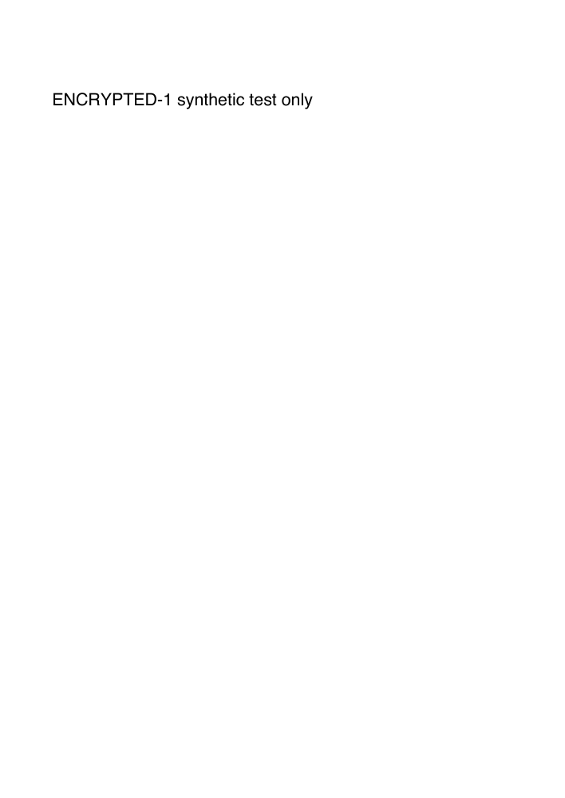

# SHR-52 — Bounded local-reader and Catalyst evidence

Recorded **30 September 2026** for [SHR-52](https://linear.app/shrey-talwar/issue/SHR-52/select-and-prove-a-local-pdf-encryption-engine-and-profile). Decision: [ADR 0013](../../adr/0013-local-pdf-encryption-engine.md), **Approved by Shrey on 30 September 2026**, ENC-1–7; approval changes no recorded proof result.

## Scope and source

Base: fetched `origin/main` **`37e970025eaff9be35a2b8d5fa0291d9c7eef0a5`**. The documentation branch was later updated to `ff3e29184b5bf039cc8938f71bbdb60f93f4ba7b` (only privacy/consent documentation changed; the probed fixture and runtime source did not). Dedicated managed worktree/branch; the owner checkout and running app were not switched, built or operated. Temporary read-only probes used its already-installed JS libraries. Bundled workspace Python/Poppler and existing Xcode/PDFKit were used. No new dependency/tool was installed, no QPDF binary ran, and no application behavior or test suite was changed.

Input: committed [SHR-45 encrypted synthetic fixture](../../../tests/fixtures/corpus/encrypted.pdf), SHA-256 **`78b89cf85f4841dcd4c228ceb3289c9c2d5c124ea6094ec72b51530201337116`**. The passwords are public test-only constants in the existing fixture generator: user `SHR45_fixture_user_only`, owner `SHR45_fixture_owner_only`; deliberate wrong attempt `SHR52_wrong_only`. No customer PDF, production password/key or cloud conversion was used. The original fixture hash was unchanged afterwards. No transformed PDF was produced.

Host: **arm64, macOS 27.0 (`26A428`)**; Xcode 27.0 (`27A266a`), macOS SDK 27.0. No minimum-OS or real Intel runtime check was made. Additional hardware details are not claimed from this run. [Environment/build hashes](environment.json) identify the temporary helper and upstream source inspected.

## Observed results

Each password case opens a **fresh reader**. Success means one readable page containing `ENCRYPTED-1`; it is not a visual-preservation certificate.

| Reader | Empty | Deliberately wrong | Correct user | Correct owner |
|---|---|---|---|---|
| pypdf 6.10.0 + cryptography 50.0.1 | match 0, no readable page | match 0, no readable page | match 1, page/marker | match 2, page/marker |
| Poppler `pdfinfo` 26.05.0 | exit 1, Incorrect password | exit 1, Incorrect password | exit 0, AES-256, 1 page | exit 0, AES-256, 1 page |
| PDF.js 6.3.289 | PasswordException code 1 | PasswordException code 2 | opens, page/marker | opens, page/marker |
| PDFKit (native macOS and arm64 Catalyst helper) | unlock false, locked, no readable page | unlock false, locked, no readable page | unlock true, permissionsStatus 1 | unlock true, permissionsStatus 2 |

Recorded outcomes: [pypdf/Poppler](fixture-readers.json), [PDF.js/pdf-lib](js-readers.json), [native PDFKit](pdfkit-reader.json), [Catalyst PDFKit](pdfkit-catalyst-reader.json).

The dictionary is `/Filter /Standard`, `/V 5`, `/R 6`, `/Length 256`, `/CFM /AESV3` for string/stream crypt filters, `/P 4294967292` (fully permissive), document-open authentication. `/EncryptMetadata` is absent (true by default); **no XMP stream exists**. Poppler reports a **PDF 1.3 header** despite R6. Tolerant-reader success therefore does not prove the approved PDF 1.7 extension-8 output profile or XMP encryption. No restricted-permission case was present.

pdf-lib 1.17.1 default load rejects the encrypted document. An `ignoreEncryption:true` load still reports `isEncrypted:true`; the probe deliberately did not save it. Installed TypeScript SaveOptions inspection found no encryption setting. This option supplies no decryption engine.

Poppler `pdftoppm` rendered the original using the known fixture user password, exit 0. Fontconfig emitted missing default-config/no writable cache warnings (retained in JSON). The image was reviewed and its synthetic marker is legible. This is only original-reader rendering; there is no before/after transformation comparison.



## Compile-compatible evidence

The standalone read-only PDFKit helper compiled/linked separately for **arm64 and x86_64 Mac Catalyst** with targets `*-apple-ios17.0-macabi`, the macOS 27 SDK and its iOSSupport framework search path. `lipo` combined them. [Recorded architecture/platform stamps](catalyst-build.txt): both slices `MACCATALYST`, minos 17.0, SDK 27.0. The arm64 Catalyst helper ran with the outcomes above. The x86_64 helper was **not run**. Its existence does not establish QPDF, an app build, Intel behavior, sandbox/storage or channel compatibility.

The helper source SHA-256 is `c17a2023517d993360ac4c088e51cdaa2a3f3d2af08b9cdc317701add5a1aa23`; Universal helper SHA-256 `929c17d2bfcb9b9ccd43ff9a5d7b2a9110daa78f439547062ac4b2866873ecbd`. Helper executables/module caches are temporary and are not included in the PR.

## Reproduce the bounded reader check

Use existing approved tools only; availability varies by machine. Do not install anything to reproduce this record without approval. The original probes lived in `/private/tmp/atepdf-shr52-proof`; no script was added to the application/test suite. A reader-only helper equivalent to the one compiled is shown below (only synthetic constants):

```swift
import Foundation
import PDFKit
let fixture = URL(fileURLWithPath: CommandLine.arguments[1])
var results: [[String: Any]] = []
for (label, password) in [("empty", ""), ("wrong", "SHR52_wrong_only"), ("user", "SHR45_fixture_user_only"), ("owner", "SHR45_fixture_owner_only")] {
  guard let doc = PDFDocument(url: fixture) else { fatalError("synthetic fixture parse failed") }
  let lockedBefore = doc.isLocked
  let match = doc.unlock(withPassword: password)
  results.append(["case": label, "encrypted": doc.isEncrypted, "lockedBefore": lockedBefore,
                  "unlockReturned": match, "lockedAfter": doc.isLocked,
                  "pages": doc.isLocked ? 0 : doc.pageCount,
                  "permissionsStatus": doc.permissionsStatus.rawValue,
                  "markerMatches": !doc.isLocked && (doc.page(at: 0)?.string?.contains("ENCRYPTED-1") ?? false)])
}
print(String(data: try JSONSerialization.data(withJSONObject: results, options: [.prettyPrinted, .sortedKeys]), encoding: .utf8)!)
```

Save that text as `main.swift` in a private temporary probe directory. On the recorded toolchain, the Catalyst commands were:

```sh
SHR52_SDK="$(xcrun --sdk macosx --show-sdk-path)"
xcrun swiftc -sdk "$SHR52_SDK" -target arm64-apple-ios17.0-macabi   -F "$SHR52_SDK/System/iOSSupport/System/Library/Frameworks"   -module-cache-path ./module-cache main.swift -o pdfkit-arm64
xcrun swiftc -sdk "$SHR52_SDK" -target x86_64-apple-ios17.0-macabi   -F "$SHR52_SDK/System/iOSSupport/System/Library/Frameworks"   -module-cache-path ./module-cache main.swift -o pdfkit-x86_64
xcrun lipo -create pdfkit-arm64 pdfkit-x86_64 -output pdfkit-universal
xcrun lipo -info pdfkit-universal
xcrun otool -l pdfkit-universal
./pdfkit-arm64 /absolute/path/to/atepdf/tests/fixtures/corpus/encrypted.pdf
```

The native macOS helper used `xcrun swiftc main.swift -module-cache-path ./module-cache -o pdfkit-native`. The Poppler reader cases used `pdfinfo`, then `-upw` for wrong/user and `-opw` for owner. These synthetic CLI credentials are **not an application interface**: real application passwords must not enter argv, environment, shell, model, logs or files. pypdf created a fresh `PdfReader(strict=True)`, called `decrypt` once per supplied fixture value and read text only on success. PDF.js created/destroyed a fresh `getDocument` task per case with `isEvalSupported:false` and a copied input byte array. The raw result JSON records versions and statuses, not password values.

## Documented versus missing proof

Primary-source QPDF API/provider/license research and a read-only pinned `v12.4.2/libqpdf/QPDF_encryption.cc` inspection are **documented evidence**. The inspected file SHA-256 is `8b4a371e58a346d3526bf172da59bf26787552cb898673587d19d4ae0f4b58c7`. It is not a compiled library or transformation result. No QPDF/libqpdf/mutool was found in the checked PATH and standard library locations; pikepdf was absent. CMake was not on PATH. ENC-6 approval for the exact dependency set and bounded proof is now recorded in ADR §12; no acquisition/build/install was performed during approval closeout. Additional tools/dependencies still need approval, and proof execution remains for separately assigned work.

The ADR's exact owner-approved bounded proof plan covers QPDF output/authentication, conforming version/Info/XMP, independent Preview/Adobe and automated readers, R4/R5/restricted/signed/malformed fixtures, preservation, password lifetime, cancellation/storage, both native slices and signed channel archives. **All are unverified here.** No PDFKit helper or pypdf-created fixture should be relabelled QPDF proof.
